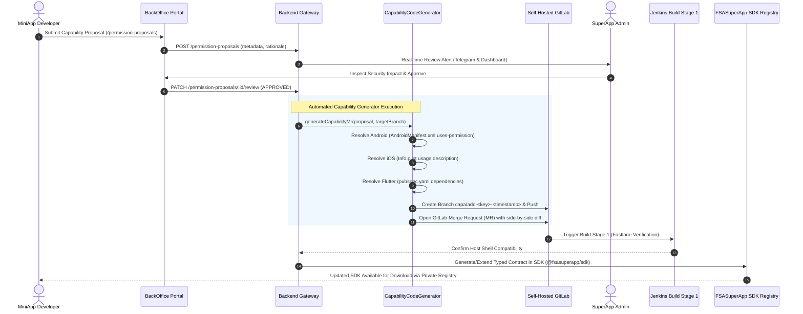

# Architecture Decision Record (ADR-004)
# Capability Generator Flow, FSASuperApp SDK Runtime Contract & Rejection Protocol

| Metadata | Details |
| :--- | :--- |
| **Status** | **Accepted & Active Standard** |
| **Date** | 2026-10-22 |
| **Target Components** | `superapp_backend` (`CapabilityCodeGeneratorService`), `superapp_backoffice`, `packages/*-sdk`, `super-app` (Flutter Host Container) |
| **Context** | Enterprise SuperApp MiniApp governance, dynamic capability extension, and cross-platform native bridge security |

---

## 1. Executive Summary & Conceptual Distinction

In the **FSA SuperApp Platform**, **Capabilities** and the **FSASuperApp SDK** serve distinct but tightly coupled architectural roles:

```
┌────────────────────────────────────────────────────────────────────────────────────────┐
│                                ARCHITECTURE TAXONOMY                                   │
├────────────────────────────────────────────────────────────────────────────────────────┤
│                                                                                        │
│  1. CAPABILITY (Platform Entitlement & Host Resource)                                  │
│     • Definition: A native host OS permission or hardware entitlement (e.g. camera,    │
│       biometrics, secure storage, face scanner sync, push notifications).              │
│     • Governance: Defined in the BackOffice Capability Catalog, governed by RBAC,      │
│       and enforced by host container security policies and OS permission dialogs.      │
│     • Entity: Permission and PermissionProposal in superapp_backend.                   │
│                                                                                        │
│  2. FSASUPERAPP SDK (Client Bridge Library & Developer Interface)                     │
│     • Definition: The versioned client library imported by MiniApp developers          │
│       (@fsasuperapp/miniapp-web-sdk, fsa_superapp_miniapp_flutter_sdk, Native .aar).  │
│     • Role: Provides typed API wrappers (FSASuperApp.canIUse(), getAuthToken(), etc.)   │
│       that translate developer method calls into asynchronous platform IPC messages.   │
│     • Runtime: Runs strictly inside the MiniApp guest context (WebView or sub-module). │
│                                                                                        │
└────────────────────────────────────────────────────────────────────────────────────────┘
```

---

## 2. Automated Capability Generator Flow

When a partner engineer requires a new native device feature or enterprise capability that is not yet cataloged in the SuperApp host shell, the platform executes an automated codegen and merge pipeline:



### Technical Implementation (`CapabilityCodeGeneratorService`)
Located in `superapp_backend/src/permissions/capability-code-generator.service.ts`:
* **AndroidManifest Injection**: Formats and inserts `<uses-permission android:name="..." />` without breaking XML schema.
* **iOS Info.plist Injection**: Formats `<key>NS...UsageDescription</key>` with localized enterprise justification.
* **Flutter `pubspec.yaml` Resolution**: Injects audited, pinned pub dependencies (e.g. `mobile_scanner: ^5.2.3`, `local_auth: ^2.2.0`).
* **Branch Isolation & Rollback**: Backs up `.bak` files prior to mutation and pushes exclusively to dedicated feature branches (`capa/add-...`), ensuring zero mutations directly on `main` or `development`.

---

## 3. FSASuperApp SDK Runtime Contract

The client bridge is standardized across all four integration methods (`WebView`, `Flutter Package`, `Native SDK`, `Deep Link`).

### Official TypeScript Contract (`super-app/packages/fsa-superapp-miniapp-web-sdk/src/types.ts`)

```typescript
export interface FSASuperAppNativeBridge {
  __initialized?: boolean;
  sdkVersion: string;
  hostVersion: string;
  _supportedCapabilities: string[];

  // 1. Dynamic Runtime Introspection
  canIUse(capabilityKey: string): Promise<boolean>;

  // 2. Staff Authentication & Single Sign-On
  getAuthToken(): Promise<AuthTokenResult>;
  getUserProfile(): Promise<UserProfileResult>;

  // 3. Capsule Lifecycle
  close(): void;

  // 4. Generic Capability Invocation
  requestCapability<T = any>(capabilityKey: string, params?: Record<string, any>): Promise<T>;

  // 5. High-Level Typed Convenience Bindings
  authenticateBiometric?(prompt?: string): Promise<BiometricResult>;
  scanQRCode?(): Promise<QRCodeResult>;
  getLocation?(options?: LocationOptions): Promise<GeoCoordinates>;
  getSecureStorage?(key: string): Promise<string | null>;
  setSecureStorage?(key: string, value: string): Promise<void>;
  removeSecureStorage?(key: string): Promise<void>;
}
```

### Official Dart Contract (`super-app/packages/fsa-superapp-miniapp-flutter-sdk/lib/src/miniapp_context.dart`)

```dart
abstract class MiniAppContext {
  SuperAppAuth get auth;
  String get hostVersion;
  List<String> get supportedCapabilities;

  Future<bool> canIUse(String capabilityKey);
  Future<T> requestCapability<T>(String capabilityKey, [Map<String, dynamic>? params]);
  Future<BiometricResult> authenticateBiometric([String? prompt]);
  Future<QRCodeResult> scanQRCode();
  void close();
}
```

---

## 4. Standardized Rejection Protocol

When a MiniApp attempts to invoke a capability that is unsupported, unwhitelisted, or denied, the SuperApp host native container **must never crash or silently hang**. It returns a standardized rejection payload conforming to the **FSA Rejection Protocol Envelope**:

### Rejection Envelope Specification

```json
{
  "code": "CAPABILITY_UNSUPPORTED",
  "capability": "biometrics",
  "message": "Host shell v1.2.0 does not support capability: biometrics. Minimum host version required: v1.4.0.",
  "hostVersion": "1.2.0",
  "supportedCapabilities": [
    "storage:secure",
    "staff:profile:read",
    "notification:push",
    "camera:qr"
  ]
}
```

### Standard Error Codes

| Error Code | Trigger Condition | Recommended MiniApp Handling |
| :--- | :--- | :--- |
| **`CAPABILITY_UNSUPPORTED`** | Host mobile shell lacks hardware driver or capability is not installed in current host version. | Fall back to manual input or alternative software flow (e.g. password instead of biometrics). |
| **`UNREGISTERED_SCOPE`** | MiniApp manifest did not declare this capability during BackOffice registration. | Show configuration alert: Developer must request capability in BackOffice. |
| **`PERMISSION_DENIED`** | End-user rejected the OS permission dialog (e.g. Camera permission denied). | Display non-blocking banner prompting user to enable permission in OS Settings. |
| **`SECURITY_VIOLATION`** | Caller domain or iframe is not in the whitelist of approved domains. | Terminate guest execution and log audit alert. |
| **`USER_CANCELLED`** | End-user dismissed biometric prompt or QR scanner without completing action. | Reset UI state gracefully; do not treat as fatal error. |

### Client SDK Error Wrapping (`CapabilityUnsupportedError`)

In `@fsasuperapp/miniapp-web-sdk`:
```typescript
try {
  const result = await FSASuperApp.authenticateBiometric("Confirm attendance clock-in");
} catch (error) {
  if (error instanceof CapabilityUnsupportedError) {
    console.warn("Device does not support biometrics. Available:", error.supportedCapabilities);
    // Graceful fallback to employee PIN or manual approval
    enablePinFallback();
  } else {
    showToast(error.message);
  }
}
```

In `fsa_superapp_miniapp_flutter_sdk`:
```dart
try {
  final bio = await context.authenticateBiometric("Verify identity");
} on CapabilityUnsupportedException catch (e) {
  debugPrint("Capability ${e.capability} not supported on host v${e.hostVersion}");
  // Graceful fallback
  showManualAttendanceDialog();
}
```

---

## 5. Security & Isolation Invariants

1. **Zero Raw Native Access**: MiniApps run in sandboxed processes or restricted WebViews. They cannot invoke arbitrary Android Java reflection or iOS Objective-C selectors.
2. **Pre-Flight Validation**: Static analysis (Semgrep Scanner #1) inspects MiniApp code at CI/CD submission time. Any calls to capabilities not declared in BackOffice fail Stage 1 immediately.
3. **Domain & Origin Whitelisting**: The host bridge injects `window.FSASuperApp` **only** into verified origins validated during domain verification.
4. **Token Isolation**: Staff session tokens returned by `getAuthToken()` are short-lived (15–60 mins) and restricted to the MiniApp's audience (`aud: miniapp_id`).

---

## 6. Document History

* **2026-10-22:** Initial approved specification of Capability Generator flow, Rejection Protocol, and unified SDK contracts across Web, Flutter, and Native.
