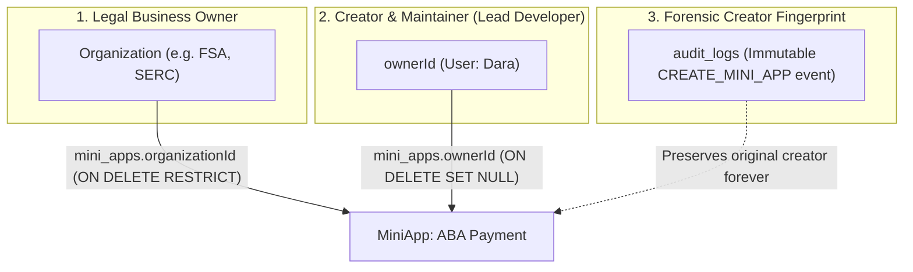

# FSA SuperApp Platform: Database Schema Master Plan

> [!IMPORTANT]
> **Planning & Specification Document**: This document outlines the reviewed database schema, entity relationships, status lifecycles, and cascade policies for the FSA SuperApp platform.
> **Status**: Review Mode (No code or migrations are executed until this plan is formally approved).

---

## 1. Executive Summary & Design Principles

The FSA SuperApp ecosystem serves as a multi-agency digital governance and MiniApp distribution hub. The database architecture is built around 5 core principles:

1. **One User = Exactly One Role (Simplified RBAC)**:
   - Removes the `user_roles` join table.
   - `users` holds a direct foreign key: `roleId UUID NOT NULL REFERENCES roles(id)`.
   - Role hierarchy (`SUPER_ADMIN` $\supset$ `ADMIN` $\supset$ `MA_DEVELOPER`) guarantees that higher roles inherit developer actions without needing multiple role records.
2. **Multi-Agency Tenancy with Strict Relational Integrity**:
   - `organizations` is the single source of truth for partner ministries and regulators (`FSA`, `SERC`, `NBC`, `ADDA`).
   - `mini_apps.organizationId` replaces loose text strings with a strict `REFERENCES organizations(id) ON DELETE RESTRICT` constraint.
   - `users.organizationId` scopes developers so they can collaborate with teammates in their agency while being blocked from other agencies' MiniApps.
3. **Decoupled Status Dimensions (Zero-Downtime Releases)**:
   - Separates **Production Lifecycle** (`ACTIVE`, `INACTIVE`, `SUSPENDED`, `DEPRECATED`, `ARCHIVED`) from **Version Release Workflow** (`releaseStatus`: `DRAFT`, `PENDING_REVIEW`, `IN_REVIEW`, `APPROVED`, `BUILDING`, `TESTING`, `ACTIVE`, `REJECTED`, `SUPERSEDED`) and **CI/CD Pipeline** (`BUILDING`, `PASSED`, `FAILED`).
   - Ensures an active MiniApp continues serving citizens without disruption while a new version is being reviewed or built.
4. **Regulatory Forensic Auditability**:
   - `audit_logs` records actions immutably without foreign key constraints to ensure records remain tamper-evident even after test entities are deleted.
5. **Strict Consumer Isolation**:
   - Mobile citizen accounts (`end_users`) remain completely separated from backoffice operator tables (`users`), protecting the platform from public attack vectors.

---

## 2. Complete Ecosystem ERD (Entity-Relationship Diagram)

```mermaid
erDiagram
    %% Backoffice Operators & RBAC (1 User = 1 Role)
    USERS {
        uuid id PK
        varchar email UK
        varchar name
        varchar avatarUrl
        varchar status "ACTIVE, PENDING_APPROVAL, DEACTIVATED"
        varchar passwordHash
        uuid roleId FK "1 User = 1 Role (SUPER_ADMIN, ADMIN, MA_DEVELOPER)"
        uuid organizationId FK "Agency Scope (ON DELETE SET NULL, nullable for SuperAdmin)"
        varchar telegramChatId "Personal direct alerts"
        varchar telegramUsername
        timestamptz createdAt
        timestamptz updatedAt
    }

    ROLES {
        uuid id PK
        varchar name UK "SUPER_ADMIN, ADMIN, MA_DEVELOPER"
        text description
        boolean isActive
        timestamptz createdAt
        timestamptz updatedAt
    }

    PERMISSIONS {
        uuid id PK
        varchar name UK
        text description
        timestamptz createdAt
        timestamptz updatedAt
    }

    ROLE_PERMISSIONS {
        uuid roleId PK, FK
        uuid permissionId PK, FK
    }

    DEVELOPER_TOKENS {
        uuid id PK
        varchar name
        varchar tokenHash UK
        varchar tokenPrefix
        jsonb scopes
        uuid userId FK "ON DELETE CASCADE"
        timestamptz expiresAt
        timestamptz lastUsedAt
        boolean isActive
        timestamptz createdAt
    }

    %% Streamlined Agency Tenancy
    ORGANIZATIONS {
        uuid id PK
        varchar name UK "e.g., Non-Bank Financial Services Authority"
        varchar code UK "e.g., FSA, SERC, NBC, ADDA"
        varchar status "ACTIVE, INACTIVE, SUSPENDED"
        text description
        varchar parentAuthority "e.g., Ministry of Economy and Finance"
        timestamptz createdAt
        timestamptz updatedAt
    }

    %% MiniApp Master Registry & Governance
    MINI_APPS {
        uuid id PK
        varchar appId UK "Reverse domain: kh.gov.fsa.insurance"
        varchar slug UK
        varchar name
        varchar tagline "1-line search card hook (e.g., Instant QR payments)"
        text description "Full detail page description & overview"
        text logo
        uuid organizationId FK "Agency Business Owner (ON DELETE RESTRICT)"
        uuid ownerId FK "Lead Developer & Maintainer (ON DELETE SET NULL)"
        varchar sharingScope "PRIVATE, ORGANIZATION, CUSTOM"
        varchar alertTelegramChatId "Telegram group for build/review alerts"
        varchar lifecycleStatus "DRAFT, ACTIVE, DEPRECATED, ARCHIVED"
        varchar availabilityStatus "ENABLED, INACTIVE, SUSPENDED"
        varchar supportEmail
        varchar integrationMethod "FLUTTER_PACKAGE, WEBVIEW, NATIVE_SDK, DEEP_LINK"
        jsonb integrationConfig
        jsonb capabilities "Array of declared capability keys (e.g., ['device:biometrics', 'fsa:payment'])"
        jsonb securityChecks
        jsonb pendingRevision "Staged non-destructive update draft"
        varchar currentReleaseVersion "Pointer to live production version (e.g., 1.0.0)"
        varchar activeTestVersion "Pointer to Sandbox QA version (e.g., 1.1.0-rc1)"
        varchar draftVersion "Pointer to authoring draft version (e.g., 1.2.0)"
        varchar verificationToken "DNS TXT or meta-tag verification token"
        boolean isDomainVerified
        timestamptz domainVerifiedAt
        timestamptz createdAt
        timestamptz updatedAt
    }

    MINI_APP_COLLABORATORS {
        uuid id PK
        uuid miniAppId FK "ON DELETE CASCADE"
        uuid userId FK "ON DELETE CASCADE"
        varchar role "COLLABORATOR, VIEWER"
        timestamptz createdAt
    }

    MINI_APP_VERSIONS {
        uuid id PK
        uuid miniAppId FK "ON DELETE CASCADE"
        varchar version "e.g., 1.2.0"
        varchar releaseStatus "DRAFT, PENDING_REVIEW, IN_REVIEW, APPROVED, BUILDING, TESTING, ACTIVE, REJECTED, SUPERSEDED, ARCHIVED"
        varchar gitRef
        varchar packageName
        varchar sourceType "GIT, ARTIFACT, WEBVIEW"
        varchar saVersion "Target SuperApp Host Version"
        text changelog
        text artifactUrl "MinIO storage object path"
        varchar apkSize
        varchar checksum "SHA256 checksum"
        varchar releasedBy
        timestamptz releasedAt
        timestamptz createdAt
        timestamptz updatedAt
    }

    MINI_APP_LEGAL {
        uuid id PK
        uuid miniAppId FK, UK "ON DELETE CASCADE"
        text termsUrl
        text termsDescription
        text privacyPolicyUrl
        text privacyPolicyDescription
        timestamptz createdAt
        timestamptz updatedAt
    }

    MINI_APP_ISSUES {
        uuid id PK
        uuid miniAppId FK "ON DELETE CASCADE"
        varchar type
        varchar severity "CRITICAL, HIGH, MEDIUM, LOW"
        text description
        varchar status "OPEN, RESOLVED, WAIVED"
        varchar classification "MINI_APP_ISSUE, SECURITY_GATE"
        jsonb metadata
        timestamptz createdAt
        timestamptz updatedAt
    }

    MINI_APP_BUILDS {
        uuid id PK
        uuid miniAppId FK "ON DELETE CASCADE"
        uuid versionId FK "ON DELETE CASCADE (REFERENCES mini_app_versions.id)"
        varchar version "Snapshot semver string"
        varchar buildStatus "IDLE, QUEUED, BUILDING, COMPLETED, FAILED, CANCELLED"
        varchar validationStatus "PENDING, RUNNING, PASSED, FAILED"
        jsonb validationStages
        jsonb validationReport
        jsonb buildStages
        text buildError
        varchar jenkinsJobUrl
        varchar actorId
        timestamptz startedAt
        timestamptz completedAt
        timestamptz createdAt
        timestamptz updatedAt
    }

    %% Capability & Proposal Engine (Device APIs & Native Bridges)
    CAPABILITY_DEFINITIONS {
        uuid id PK
        varchar key UK "e.g., device:biometrics, fsa:payment, hardware:camera"
        varchar name
        text description
        varchar category "HARDWARE, DATA, FINANCIAL, SYSTEM"
        boolean isActive
        boolean isDeprecated
        varchar introducedInVersion
        varchar minSuperAppVersion
        varchar maxSuperAppVersion
        jsonb metadata
        timestamptz createdAt
        timestamptz updatedAt
    }

    CAPABILITY_PROPOSALS {
        uuid id PK
        varchar capabilityKey
        varchar capabilityName
        text description
        uuid miniAppId FK "ON DELETE CASCADE"
        uuid requestedBy FK "ON DELETE SET NULL"
        varchar status "PENDING_REVIEW, APPROVED, REJECTED"
        text adminDecisionReason
        varchar targetSuperAppVersion
        varchar implementedInSuperAppVersion
        jsonb metadata
        timestamptz createdAt
        timestamptz updatedAt
    }

    %% System Auditing & Notifications
    AUDIT_LOGS {
        uuid id PK
        varchar actorId "Untyped UUID to preserve log after user deletion"
        varchar actorName "Snapshot at event time (e.g., Dara Sok)"
        varchar actorEmail "Snapshot at event time (e.g., dara@serc.gov.kh)"
        varchar actorRole "Snapshot at event time (e.g., MA_DEVELOPER)"
        varchar action "e.g., APPROVE_MINI_APP, REASSIGN_ROLE"
        varchar resourceType "MiniApp, User, Organization"
        varchar resourceId "Untyped UUID to preserve log after resource deletion"
        jsonb oldValue
        jsonb newValue
        jsonb metadata
        varchar ipAddress
        varchar userAgent
        timestamptz createdAt
    }

    NOTIFICATIONS {
        uuid id PK
        varchar type
        varchar title
        text message
        boolean isRead
        jsonb metadata
        uuid userId FK "ON DELETE CASCADE"
        uuid miniAppId FK "ON DELETE CASCADE"
        timestamptz createdAt
        timestamptz updatedAt
    }

    SYSTEM_SETTINGS {
        varchar key PK "e.g., PIPELINE_TIMEOUT_SECONDS"
        jsonb value
        varchar description
        timestamptz createdAt
        timestamptz updatedAt
    }

    %% Citizen Mobile Domain (Completely Isolated Boundary)
    END_USERS {
        uuid id PK
        varchar email UK "Enforced lowercase"
        varchar name
        varchar passwordHash "Scrypt hash"
        timestamptz emailVerifiedAt
        varchar status "ACTIVE, DISABLED, LOCKED"
        int failedLoginCount
        timestamptz lockedUntil
        timestamptz createdAt
        timestamptz updatedAt
    }

    END_USER_REFRESH_TOKENS {
        uuid id PK
        uuid familyId "Token rotation family"
        varchar tokenHash UK "SHA-256"
        uuid endUserId FK "ON DELETE CASCADE (REFERENCES end_users.id)"
        varchar userAgent
        timestamptz expiresAt
        timestamptz rotatedAt
        timestamptz revokedAt
        timestamptz createdAt
    }

    %% Relational Cardinalities
    ROLES ||--o{ USERS : "assigned to (roleId)"
    ORGANIZATIONS ||--o{ USERS : "scopes (organizationId)"
    ORGANIZATIONS ||--o{ MINI_APPS : "owns (organizationId)"
    ROLES ||--|{ ROLE_PERMISSIONS : "configures"
    PERMISSIONS ||--|{ ROLE_PERMISSIONS : "granted"
    
    USERS ||--o{ MINI_APPS : "maintains (ownerId)"
    MINI_APPS ||--o{ MINI_APP_COLLABORATORS : "has collaborators"
    USERS ||--o{ MINI_APP_COLLABORATORS : "collaborates on"
    USERS ||--o{ NOTIFICATIONS : "receives"
    USERS ||--o{ DEVELOPER_TOKENS : "issues"

    MINI_APPS ||--|{ MINI_APP_VERSIONS : "contains"
    MINI_APPS ||--|| MINI_APP_LEGAL : "compliance"
    MINI_APPS ||--o{ MINI_APP_ISSUES : "security gates"
    MINI_APPS ||--o{ MINI_APP_BUILDS : "build history"
    MINI_APP_VERSIONS ||--o{ MINI_APP_BUILDS : "compiles (versionId)"
    MINI_APPS ||--o{ CAPABILITY_PROPOSALS : "proposes"
    USERS ||--o{ CAPABILITY_PROPOSALS : "requested by"
    MINI_APPS ||--o{ NOTIFICATIONS : "triggers"

    END_USERS ||--o{ END_USER_REFRESH_TOKENS : "session tokens (endUserId)"
```



---

## 3. Decoupled Status Architecture & Workflows

To prevent production outages when MiniApps are updated, the platform decouples statuses into **4 independent dimensions**:

```mermaid
graph TD
    subgraph D1 ["Dimension 1: MiniApp Lifecycle (High-Level State)"]
        DRAFT["DRAFT"] --> ACTIVE["ACTIVE"]
        ACTIVE --> DEPRECATED["DEPRECATED"]
        DEPRECATED --> ARCHIVED["ARCHIVED"]
        ACTIVE --> ARCHIVED
    end

    subgraph D2 ["Dimension 2: Runtime Availability Gate (Killswitch)"]
        ENABLED["ENABLED (Normal Public Traffic)"]
        INACTIVE["INACTIVE (Maintenance by Developer/Agency)"]
        SUSPENDED["SUSPENDED (Takedown by SuperAdmin)"]
    end

    subgraph D3 ["Dimension 3: Release Workflow (Per Version Release)"]
        SUB_DRAFT["1. DRAFT (Authoring)"] --> PENDING_REV["2. PENDING_REVIEW (Pre-flight passed)"]
        PENDING_REV --> IN_REV["3. IN_REVIEW (Approval Gate)"]
        IN_REV --> REJECTED["REJECTED (Requires revision)"]
        IN_REV --> APPROVED["4. APPROVED (Staged for Build)"]
        APPROVED --> BUILDING["5. BUILDING (Jenkins Pipeline)"]
        BUILDING --> BUILD_FAILED["BUILD_FAILED (Compilation error)"]
        BUILDING --> TESTING["6. TESTING (Sandbox QA / Device Verification)"]
        TESTING --> REJECTED
        TESTING -->|"Admin Decision: Promote"| PROMOTED["7. ACTIVE (Promoted to Live Store)"]
    end

    subgraph D4 ["Dimension 4: Build & CI/CD Pipeline Details (miniapp_builds)"]
        IDLE["IDLE (Standby / No active build)"] --> QUEUED["QUEUED (Waiting in Jenkins job queue)"]
        QUEUED --> COMPILING["BUILDING (Compiling Flutter & generating native bridges)"]
        COMPILING --> BUILT["COMPLETED (Artifacts pushed to MinIO)"]
        COMPILING --> FAILED["FAILED (Compile error or test failure)"]
        QUEUED --> CANCELLED["CANCELLED (Aborted by operator)"]
    end
```



### Detailed Status Comparison Matrix

| Status | Who Controls It? | Available to Citizens? | Business Purpose | Reversibility |
| :--- | :--- | :---: | :--- | :---: |
| **`ACTIVE`** | SuperAdmin / System | **YES** | Live, healthy, and accessible in mobile SuperApp. | N/A |
| **`INACTIVE`** | **Agency / Developer** *(or Admin)* | **NO** | **Normal business decision**: Scheduled maintenance, backend upgrade, or temporary service pause. | **YES** (Developer or Admin can re-enable anytime). |
| **`SUSPENDED`** | **SuperAdmin ONLY** | **NO** | **Regulatory/Security enforcement**: Critical zero-day vulnerability, policy breach, or fraud alert. | **YES, but restricted**: Requires SuperAdmin clearance and audit sign-off. |
| **`DEPRECATED`** | SuperAdmin / Agency | **YES** *(with warning)* | **Sunset period**: Being phased out or replaced by a new service. Citizens can still access it during transition. | **YES** (if deprecation is revoked). |
| **`ARCHIVED`** | SuperAdmin | **NO** | **Permanent Retirement**: MiniApp discontinued. Retained strictly for audit and historical records. | **NO** (requires explicit administrative restore). |

---

## 4. Why Some Tables Have No Direct Foreign Keys

In enterprise systems, omitting foreign keys is done deliberately for resilience and security:

1. **`audit_logs` (`actorId`, `actorName`, `actorEmail`, `actorRole`, `resourceId`)**:
   - **No Foreign Keys**: If a foreign key with `ON DELETE CASCADE` were attached, deleting a test user would **permanently destroy the audit trail** of what that user did. If `ON DELETE RESTRICT` were used, you could **never delete any user** because audit logs would block deletion forever. Using untyped UUID strings ensures audit logs remain **100% immutable and forensically permanent**.
   - **Identity Snapshotting (`actorName`, `actorEmail`, `actorRole`)**: Storing snapshots of the actor's name, email, and role at the moment of the event enables instant human readability in backoffice dashboards without expensive SQL joins. More importantly, if an employee leaves the agency or their user account is later removed, regulatory auditors can still immediately identify exactly who initiated every deployment, role change, or security gate override.
2. **`capability_definitions` (`key`, `name`)**:
   - Functions as a dynamic system catalog / dictionary of bridge APIs (Camera, Biometrics, Payment) supported by the Flutter host shell.
   - MiniApps store their requested capability keys in `mini_apps.capabilities` (JSONB array), which is validated dynamically during CI/CD builds rather than through a rigid join table. This cleanly separates mobile host shell bridge capabilities from operator RBAC permissions (`permissions` table).
3. **`system_settings` (`key`, `value`)**:
   - Global key-value environment configuration (pipeline timeouts, MinIO retention rules, Telegram bot webhooks). It is not owned by any entity.
4. **`end_users` & `end_user_refresh_tokens`**:
   - Zero-Trust boundary: Public mobile consumers are completely isolated from backoffice operator tables, preventing public traffic denial-of-service or privilege escalation from impacting admin infrastructure.

---

## 5. Streamlined `organizations` Schema & Behavioral Matrix

### Streamlined Table Definition
```sql
CREATE TABLE organizations (
    id UUID PRIMARY KEY DEFAULT gen_random_uuid(),
    name VARCHAR(255) NOT NULL UNIQUE,
    code VARCHAR(50) NOT NULL UNIQUE,             -- e.g., 'FSA', 'SERC', 'NBC', 'ADDA'
    status VARCHAR(50) NOT NULL DEFAULT 'ACTIVE', -- 'ACTIVE', 'INACTIVE', 'SUSPENDED'
    description TEXT NULL,
    "parentAuthority" VARCHAR(255) NULL,          -- e.g., 'Ministry of Economy and Finance'
    "createdAt" TIMESTAMPTZ NOT NULL DEFAULT NOW(),
    "updatedAt" TIMESTAMPTZ NOT NULL DEFAULT NOW()
);
```

### What Happens on Organization UPDATE or DELETE?

| Event | Target Entity | Database & System Action | Business Guarantee |
| :--- | :--- | :--- | :--- |
| **UPDATE Name, Description, Parent** | `mini_apps`, `users` | Relational joins use immutable `organizationId` UUID. Updates reflect immediately. | Zero data backfills needed. All backoffice badges and app listings update instantly. |
| **UPDATE Status to `INACTIVE` / `SUSPENDED`** | `mini_apps`, `users` | Security middleware automatically flags dependent MiniApps as unavailable and pauses developer build submissions. | Prevents decommissioned or penalized agencies from pushing unverified code. |
| **DELETE Organization** | `mini_apps` | **`ON DELETE RESTRICT`**: PostgreSQL **blocks and rejects deletion** if the organization has any MiniApps. | **Safety Guarantee**: Protects against accidental deletion of an agency that has live apps on citizens' phones. |
| **DELETE Organization** | `users` | **`ON DELETE SET NULL`**: If an agency with zero apps is deleted, assigned users have their `organizationId` set to `NULL`. | Staff accounts are preserved as unassigned operators instead of being deleted. |

---

## 6. One-User-to-One-Role Implementation

```sql
-- Replace user_roles junction table with direct foreign key
ALTER TABLE users 
    ADD COLUMN "roleId" UUID NOT NULL 
    REFERENCES roles(id) ON DELETE RESTRICT;

DROP TABLE IF EXISTS user_roles;
```

### Role Hierarchy Mapping
```
SUPER_ADMIN (Root platform owner, system configs, approvals)
  └── ADMIN (Platform reviewer, partner agency oversight, audit logs)
        └── MA_DEVELOPER (MiniApp building, sandbox testing, submitting builds)
```
- Because higher roles inherit all actions of lower roles, **one user never needs more than one role**.

---

## 7. MiniApp Ownership & Developer Registration Architecture

Based on your design decision, **Creator and Maintainer are unified into a single field**: `mini_apps.ownerId`. We do not need a redundant `createdById` column because the original creation event is already permanently preserved in `audit_logs`.



---

### 1. Mandatory Organization Selection on Developer Signup

When a user registers for an account as an `MA_DEVELOPER`:
1. **Mandatory Agency Selection**: The registration form **requires** selecting their specific `organizationId` (e.g., `SERC`, `FSA`).
2. **SuperAdmin Approval**: The account is created with `status = 'PENDING_APPROVAL'`. A SuperAdmin verifies and approves the developer for that specific organization.
3. **Automatic Agency Inheritance**: When an approved developer registers a MiniApp:
   - `mini_apps.organizationId` is automatically set to `currentUser.organizationId`.
   - `mini_apps.ownerId` is set to `currentUser.id`.
   - The developer cannot create MiniApps under a different agency.

---

### 2. Hybrid Agency Collaboration & Governance Model (Option C)

We preserve the clean 3-role system (`SUPER_ADMIN`, `ADMIN`, `MA_DEVELOPER`) while enforcing fine-grained team collaboration and governance at the agency and resource level:

```
Agency Tenancy (users.organizationId === mini_apps.organizationId)
  ├── Agency Teammates: Build, test, edit draft metadata, push code, inspect logs
  └── Lead Maintainer (ownerId): Submit for SuperAdmin review, toggle runtime killswitch (ENABLED/INACTIVE)
```

#### Capability Breakdown within Agency

| Action | Agency Teammates (`same org`) | Lead Developer (`ownerId`) | SuperAdmin / Admin |
| :--- | :---: | :---: | :---: |
| **View MiniApp, Builds, Issues** | ✅ Allowed | ✅ Allowed | ✅ Allowed |
| **Edit Draft Metadata & Configs** | ✅ Allowed | ✅ Allowed | ✅ Allowed |
| **Trigger Build Pipeline (Jenkins)** | ✅ Allowed | ✅ Allowed | ✅ Allowed |
| **Sandbox QA & Device Testing** | ✅ Allowed | ✅ Allowed | ✅ Allowed |
| **Propose SuperApp Capabilities** | ✅ Allowed | ✅ Allowed | ✅ Allowed |
| **Submit Release for Review (`DRAFT` $\rightarrow$ `IN_REVIEW`)** | ❌ Blocked | ✅ **Allowed** | ✅ Allowed |
| **Toggle Availability (`ENABLED` $\leftrightarrow$ `INACTIVE`)** | ❌ Blocked | ✅ **Allowed** | ✅ Allowed |
| **Reassign Lead Maintainer (`ownerId`)** | ❌ Blocked | ❌ Blocked | ✅ **Admin Only** |
| **Access Other Agencies' MiniApps** | ❌ **FORBIDDEN** | ❌ **FORBIDDEN** | ✅ Allowed |

#### Backend Access Guard Implementation

```typescript
// Step 1: RBAC Capability Check
if (!user.permissions.includes(requiredPermission)) {
  throw new ForbiddenException('Insufficient role permissions');
}

// Step 2: Cross-Agency Strict Isolation
if (user.role === 'MA_DEVELOPER') {
  if (user.organizationId !== miniApp.organizationId) {
    throw new ForbiddenException("Access Denied: You cannot access another agency's MiniApp");
  }

  // Step 3: Sensitive Governance Gate (Submit Review, Toggle Availability)
  const isLeadMaintainer = miniApp.ownerId === user.id;
  const isGovernanceAction = [
    'miniapp:submit_review',
    'miniapp:toggle_availability',
    'miniapp:delete_draft'
  ].includes(action);

  if (isGovernanceAction && !isLeadMaintainer) {
    throw new ForbiddenException(
      'Only the Lead Developer (ownerId) or a SuperAdmin can submit releases or change availability'
    );
  }
}
```

---

### 3. Granular Sharing & Collaborators Architecture (Approach A)

To support **Private Drafts**, **Whole Agency Sharing**, and **Specific Teammates Collaboration**, `mini_apps` introduces `sharingScope` coupled with `MINI_APP_COLLABORATORS`:

```sql
CREATE TABLE mini_app_collaborators (
    id UUID PRIMARY KEY DEFAULT gen_random_uuid(),
    "miniAppId" UUID NOT NULL REFERENCES mini_apps(id) ON DELETE CASCADE,
    "userId" UUID NOT NULL REFERENCES users(id) ON DELETE CASCADE,
    role VARCHAR(50) NOT NULL DEFAULT 'DEVELOPER', -- 'ADMIN' (co-maintainer), 'DEVELOPER' (build/test/push), 'VIEWER' (read-only QA)
    "createdAt" TIMESTAMPTZ NOT NULL DEFAULT NOW(),
    UNIQUE("miniAppId", "userId")
);
```

#### A. Authority Matrix: App Owner vs. Collaborator Roles

There is a strict architectural boundary between **System Persona**, **App Ownership**, and **Collaborator Roles**:

| Authority Scope | Entity Source | Permitted Actions |
| :--- | :--- | :--- |
| **Primary Owner** (Lead Maintainer) | `mini_apps.ownerId` | **Supreme project authority**: Only the Owner (or platform SuperAdmin) can **delete the MiniApp**, **transfer ownership**, or reassign collaborator permissions. |
| **`ADMIN`** (Co-Maintainer) | `mini_app_collaborators.role = 'ADMIN'` | Can edit configuration, legal policies, invite/remove collaborators within agency, and submit revisions for review. *Cannot delete app or transfer ownership.* |
| **`DEVELOPER`** (Core Contributor) | `mini_app_collaborators.role = 'DEVELOPER'` | Can push git code/packages, trigger Jenkins/Fastlane builds, run sandbox simulators, and inspect build stages. *Cannot modify governance legal policies or manage team members.* |
| **`VIEWER`** (Auditor / QA) | `mini_app_collaborators.role = 'VIEWER'` | Read-only inspection. Can run sandbox simulators, download test APKs, and view audit & security logs. |

---

#### B. Zero-Trust Collaborator Invitation Protocol (Active Backoffice Users Only)

> [!CAUTION]
> **Security Requirement: No Public / External Auto-Approvals**
> In compliance with FSA and central financial governance, **developers cannot bypass SuperAdmin vetting to create active accounts via invite links**. All collaborators must be verified backoffice identities.

1. **Prerequisite for Collaboration**:
   - A collaborator **must already possess an approved, active account** (`status = 'ACTIVE'`) in the backoffice.
   - The user must belong to the **exact same agency/organization** (`user.organizationId === miniApp.organizationId`).
2. **If an Engineer Does Not Have an Account Yet**:
   - They must complete the official registration process (`/signup`).
   - The account enters `status = 'PENDING_APPROVAL'`.
   - The SuperAdmin or Organization Admin formally reviews and approves the account.
   - Once `status = 'ACTIVE'`, the MiniApp Owner can immediately find and assign them in the **Team & Collaborators** tab.
3. **Shareable Invite Link Token Verification Guard (`GET /api/mini-apps/:id/invite-token`)**:
   - When a recipient opens an invite link (`/miniapps/:id/join?token=...`):
     - **Auth Check**: Recipient must be logged in. If unauthenticated, redirect to `/login`.
     - **Status Check**: Enforce `user.status === 'ACTIVE'`. Non-approved users are denied.
     - **Agency Firewall**: Enforce `user.organizationId === miniApp.organizationId`. Users from other agencies are rejected with `403 Forbidden`.
     - **Enrollment**: Only upon passing all three guards is the record written to `mini_app_collaborators`.

---

#### C. Sharing Scope Resolution Rules

```typescript
// 1. Cross-Agency Strict Firewall (Enforced on all requests)
if (user.role === 'MA_DEVELOPER' && user.organizationId !== miniApp.organizationId) {
  throw new ForbiddenException("Access Denied: Belongs to another agency");
}

// 2. Lead Maintainer and Platform Admins always have access
if (user.id === miniApp.ownerId || ['SUPER_ADMIN', 'ADMIN'].includes(user.role)) {
  return true;
}

// 3. Evaluate Sharing Scope for Teammates
if (miniApp.sharingScope === 'ORGANIZATION') {
  return true; // All verified teammates in same org can view/collaborate
}

if (miniApp.sharingScope === 'CUSTOM') {
  const isCollaborator = await collaboratorRepo.findOne({
    where: { miniAppId: miniApp.id, userId: user.id }
  });
  if (!isCollaborator) throw new ForbiddenException("Private MiniApp: You are not an invited collaborator");
  return true;
}

// Default 'PRIVATE': Only ownerId and Platform Admins can view/edit
throw new ForbiddenException("This MiniApp is a Private Draft");
```

---

### 4. Relational Foreign Key Direction Guide

In relational SQL databases (PostgreSQL), **the Child (Many) side always stores the Foreign Key**, pointing back to the **Parent (One) side**:

```
      ORGANIZATIONS (Parent)
        ▲             ▲
        │ 1:N         │ 1:N
        │             │
      USERS        MINI_APPS (Child)
   (organizationId) (organizationId, ownerId)
        ▲             ▲
        │             │
        └─── MINI_APP_COLLABORATORS ───┘
                (miniAppId, userId)
```

1. **Why `organizations` does NOT store `miniAppId` or `userId`**:
   - One agency (`SERC`) has **many MiniApps** and **many staff Users**.
   - If `organizations` had a `miniAppId` column, an agency could only ever own 1 single MiniApp! Storing `organizationId` on `mini_apps` allows an agency to own unlimited MiniApps.
2. **Why `users` does NOT store `miniAppId`**:
   - A single developer can create or maintain **multiple MiniApps**.
   - Storing `ownerId` on `mini_apps` allows developers to maintain multiple apps without modifying the `users` table.
3. **Many-to-Many Collaboration**:
   - Since multiple developers can collaborate on multiple MiniApps, the junction table `mini_app_collaborators` holds `("miniAppId", "userId")`.
4. **Cleaned Notification Channel**:
   - `users.teamTelegramChatId` is removed to eliminate profile duplication.
   - `mini_apps.teamName` is removed (agency identity comes directly from `organizations.name`).
   - `mini_apps.alertTelegramChatId` is retained as the project's Jenkins CI/CD and review broadcast channel.
5. **Cleaned Storefront Metadata**:
   - `shortDescription` and `fullDescription` are renamed to **`tagline`** (1-line card subtitle) and **`description`** (complete detail page content).
   - Redundant duplicate column `version` is removed in favor of explicit pointer **`currentReleaseVersion`**.

---

### 5. What Happens When a Developer Account is Deleted or Reassigned?

| Entity | Action Taken | Result & Safety Guarantee |
| :--- | :--- | :--- |
| **MiniApp** | **NOT deleted!** | The application legally belongs to the `Organization`, not the individual employee. Production apps continue running without interruption. |
| **`ownerId`** | **Becomes `NULL` (`ON DELETE SET NULL`)** | Signals to the SuperAdmin in the backoffice that this MiniApp currently has no assigned maintainer. |
| **Ownership Transfer** | SuperAdmin / Admin reassigns | SuperAdmin clicks **"Assign Maintainer"** and selects an active developer from the existing `mini_app_collaborators` or same organization. |
| **Historical Creator** | Preserved in `audit_logs` | The original registration event (`action: 'CREATE_MINI_APP'`, `actorId`, `actorName`, `actorEmail`) remains permanently in `audit_logs` for regulatory compliance. |

---

## 8. MiniApp Normalization Audit: Keep, Remove, and Move Breakdown

To eliminate prototype technical debt and achieve high-performance relational normalization, every column from the legacy `mini_apps` entity has been audited into one of three categories:

### 1. Complete Column Audit Matrix

| Legacy Attribute | Decision | Clean Target Table | Architectural Rationale |
| :--- | :---: | :---: | :--- |
| **`id`, `appId`, `slug`** | **KEEP** | `mini_apps` | Core immutable identities (`kh.gov.fsa.insurance`). |
| **`name`, `logo`** | **KEEP** | `mini_apps` | Primary brand and storefront listing presentation. |
| **`tagline`** | **KEEP** | `mini_apps` | Renamed from `shortDescription`. Crisp 1-line hook for search cards and grids. |
| **`description`** | **KEEP** | `mini_apps` | Renamed from `fullDescription`. Multi-paragraph guide for MiniApp Detail Page. |
| **`organizationId`** | **KEEP** | `mini_apps` | Relational FK to `organizations(id)` (agency business owner). |
| **`ownerId`** | **KEEP** | `mini_apps` | Relational FK to `users(id)` (Lead Developer maintainer). |
| **`sharingScope`** | **KEEP** | `mini_apps` | Visibility scope: `'PRIVATE'`, `'ORGANIZATION'`, `'CUSTOM'`. |
| **`alertTelegramChatId`** | **KEEP** | `mini_apps` | Renamed from `teamTelegramChatId`. Telegram group webhook for CI/CD alerts. |
| **`lifecycleStatus`** | **KEEP** | `mini_apps` | Dimension 1: `'DRAFT'`, `'ACTIVE'`, `'DEPRECATED'`, `'ARCHIVED'`. |
| **`availabilityStatus`** | **KEEP** | `mini_apps` | Dimension 2: `'ENABLED'`, `'INACTIVE'`, `'SUSPENDED'`. |
| **`supportEmail`** | **KEEP** | `mini_apps` | Official support contact for public citizens. |
| **`integrationMethod`, `integrationConfig`** | **KEEP** | `mini_apps` | Execution method (`FLUTTER_PACKAGE`, `WEBVIEW`, `NATIVE_SDK`, `DEEP_LINK`). |
| **`capabilities`, `securityChecks`** | **KEEP** | `mini_apps` | Bridge capabilities (`device:biometrics`, `fsa:payment`) and scanner gate checklists. |
| **`pendingRevision`** | **KEEP** | `mini_apps` | Staged draft metadata allowing zero-downtime store updates for live apps. |
| **`verificationToken`, `isDomainVerified`, `domainVerifiedAt`** | **KEEP** | `mini_apps` | Automated DNS TXT and meta-tag ownership proof for WebViews. |
| **`currentReleaseVersion`, `activeTestVersion`, `draftVersion`** | **KEEP** | `mini_apps` | Fast pointer cache pointing to active version records. |
| **`createdAt`, `updatedAt`** | **KEEP** | `mini_apps` | Standard entity timestamps. |
| ─── | ─── | ─── | ─── |
| **`teamName`** | ❌ **REMOVE** | *None (Deleted)* | Redundant. Agency is `organizations.name`; team members in `mini_app_collaborators`. |
| **`teamTelegramChatId` (on users)** | ❌ **REMOVE** | *None (Deleted)* | Eliminated. Developers are individual people with personal `telegramChatId`. |
| **`organization`, `organizationCode`** | ❌ **REMOVE** | *None (Deleted)* | Loose text strings replaced by strict `organizationId REFERENCES organizations(id)`. |
| **`ownerName`, `ownerEmail`** | ❌ **REMOVE** | *None (Deleted)* | Replaced by relational join `ownerId REFERENCES users(id)`. |
| **`category`** | ❌ **REMOVE** | *None (Deleted)* | Replaced by `organizations.name` and modern SuperApp taxonomy. |
| **`status`** | ❌ **REMOVE** | *None (Deleted)* | Monolithic single enum replaced by decoupled status dimensions. |
| **`version`** | ❌ **REMOVE** | *None (Deleted)* | Redundant duplicate of `currentReleaseVersion`. |
| **`versionHistory` (JSONB)** | ❌ **REMOVE** | *None (Deleted)* | Monolithic JSONB array replaced by relational table `mini_app_versions`. |
| ─── | ─── | ─── | ─── |
| **`termsUrl`, `termsDescription`** | 🔄 **MOVE** | **`mini_app_legal`** | Legal policies are large texts that change independently of software releases. |
| **`privacyPolicyUrl`, `privacyPolicyDescription`** | 🔄 **MOVE** | **`mini_app_legal`** | Isolates compliance data from high-frequency storefront catalog queries. |
| **`buildStatus`, `buildStages`, `buildError`** | 🔄 **MOVE** | **`mini_app_builds`** | **Critical**: Prevents a failing test build from changing the status of a live app! |
| **`validationStatus`, `validationStages`, `validationReport`, `validationErrors`** | 🔄 **MOVE** | **`mini_app_builds`** | Security scans belong to specific pipeline runs, not the parent app. |
| **`artifactUrl`, `apkSize`, `checksum`, `gitRef`, `changelog`, `saVersion`** | 🔄 **MOVE** | **`mini_app_versions`** | Each version release is distinct (v1.0.0 is live while v1.1.0 is in QA). |

---

### 2. Cleaned `mini_apps` Table DDL

```sql
CREATE TABLE mini_apps (
    id UUID PRIMARY KEY DEFAULT gen_random_uuid(),
    "appId" VARCHAR(255) NOT NULL UNIQUE,          -- e.g., 'kh.gov.fsa.insurance'
    slug VARCHAR(255) NOT NULL UNIQUE,             -- e.g., 'fsa-insurance'
    name VARCHAR(255) NOT NULL,
    tagline VARCHAR(255) NULL,                     -- 1-line search card hook
    description TEXT NULL,                         -- Full detail page description & overview
    logo TEXT NULL,
    
    -- Agency Tenancy & Ownership
    "organizationId" UUID NOT NULL REFERENCES organizations(id) ON DELETE RESTRICT,
    "ownerId" UUID NULL REFERENCES users(id) ON DELETE SET NULL,
    
    -- Team Collaboration & Alerting
    "sharingScope" VARCHAR(50) NOT NULL DEFAULT 'PRIVATE', -- 'PRIVATE', 'ORGANIZATION', 'CUSTOM'
    "alertTelegramChatId" VARCHAR(100) NULL,               -- Telegram group for build/review alerts
    
    -- Decoupled Status Dimensions
    "lifecycleStatus" VARCHAR(50) NOT NULL DEFAULT 'DRAFT',        -- 'DRAFT', 'ACTIVE', 'DEPRECATED', 'ARCHIVED'
    "availabilityStatus" VARCHAR(50) NOT NULL DEFAULT 'ENABLED',    -- 'ENABLED', 'INACTIVE', 'SUSPENDED'
    
    -- Integration & Execution Engine
    "supportEmail" VARCHAR(255) NULL,
    "integrationMethod" VARCHAR(50) NOT NULL,                      -- 'FLUTTER_PACKAGE', 'WEBVIEW', 'NATIVE_SDK'
    "integrationConfig" JSONB NULL,
    capabilities JSONB NOT NULL DEFAULT '[]',                      -- ['device:biometrics', 'fsa:payment']
    "securityChecks" JSONB NOT NULL DEFAULT '[]',
    "pendingRevision" JSONB NULL,                                  -- Staged non-destructive store metadata draft
    
    -- Domain Verification (for WebViews)
    "verificationToken" VARCHAR(255) NULL,
    "isDomainVerified" BOOLEAN NOT NULL DEFAULT false,
    "domainVerifiedAt" TIMESTAMPTZ NULL,
    
    -- Fast Version Pointer Cache
    "currentReleaseVersion" VARCHAR(50) NULL,                      -- Pointer to live production version (e.g., '1.0.0')
    "activeTestVersion" VARCHAR(50) NULL,                          -- Pointer to Sandbox QA version (e.g., '1.1.0-rc1')
    "draftVersion" VARCHAR(50) NULL,                               -- Pointer to authoring draft version (e.g., '1.2.0')
    
    "createdAt" TIMESTAMPTZ NOT NULL DEFAULT NOW(),
    "updatedAt" TIMESTAMPTZ NOT NULL DEFAULT NOW()
);
```

---

## 9. Phased Implementation Roadmap & Verification Evidence Plan

Every task in this roadmap requires verifiable evidence (database query outputs, compilation status, automated test passes, or API responses) before marking as completed:

## 9. Phased Implementation Roadmap & Verification Evidence Plan

Every task in this roadmap requires verifiable evidence (database query outputs, compilation status, automated test passes, or API responses) before marking as completed:

```
[x] Phase 1: PostgreSQL Database Migration (COMPLETED & VERIFIED)
    [x] Task 1.1: Generate comprehensive migration script (`superapp_backend/scripts/migrate-to-master-schema.mjs`).
    [x] Task 1.2: Run migration script against the PostgreSQL database (`dps_db`).
    --> Evidence: Executed with code 0 on live DB. 22 tables verified, `capability_definitions`, `capability_proposals`, and `mini_app_collaborators` created; `user_roles` and `miniapp_activities` dropped. Columns `tagline`, `description`, `alertTelegramChatId`, `capabilities`, `sharingScope`, `lifecycleStatus`, `availabilityStatus` verified in PostgreSQL.

[x] Phase 2: Backend TypeORM Entities, Modules & Files Refactor (COMPLETED & VERIFIED)
    [x] Task 2.1: Refactor `User` entity (direct `roleId UUID`, direct `organizationId UUID`, remove `isActive`, remove `teamTelegramChatId`).
    [x] Task 2.2: Refactor `MiniApp` entity (rename `tagline`, `description`, `alertTelegramChatId`, add `sharingScope`, `capabilities`, `verificationToken`, remove dead weight).
    [x] Task 2.3: Create `MiniAppCollaborator` entity and deprecate `MiniAppActivity`.
    [x] Task 2.4: Rename modules, controllers, services, DTOs, and files to match new entities:
        - `src/permissions/` -> `src/capabilities/` (`CapabilitiesModule`, `CapabilitiesService`, `CapabilitiesController`, `capability-definition.entity.ts`, `capability-code-generator.service.ts`).
        - `src/permission-proposals/` -> `src/capability-proposals/` (`CapabilityProposalsModule`, `CapabilityProposalsService`, `CapabilityProposalsController`, `capability-proposal.entity.ts`).
        - Update imports in `app.module.ts`, `miniapps.module.ts`, etc.
    [x] Task 2.5: Refactor `EndUserRefreshToken` (`endUserId`) and `MiniAppBuild` (`versionId`).
    --> Evidence: NestJS TypeScript compilation succeeds (`pnpm run build` with 0 errors).

[x] Phase 3: Seeder & Bootstrap Synchronization Engine (COMPLETED & VERIFIED)
    [x] Task 3.1: Implement idempotent seeding of the 11 Clean FSA Organizations in `seeder.service.ts` (parentAuthority = 'Non-Bank Financial Services Authority', clean names without acronyms in parentheses).
    [x] Task 3.2: Seed the 3 Canonical Roles (`SUPER_ADMIN`, `ADMIN`, `MA_DEVELOPER`) and RBAC permissions; purge legacy roles (`MINI_APP_MANAGER`).
    [x] Task 3.3: Seed the 4 Official Accounts (`molikakhorn71@gmail.com`, `thavorac.chun@gmail.com`, `sea.hutmonineat@gmail.com`, `lymoly1122@gmail.com`) with `Password123!@#` and assign to FTC. Purged all mock accounts.
    [x] Task 3.4: Integrate automated SuperApp Flutter capabilities sync from GitLab on startup (`syncCapabilitiesFromGitLab`) for both local and production.
    --> Evidence: `scripts/verify-seed-and-bootstrap.mjs` executed with code 0:
        - 11 FSA organizations verified with parent authority.
        - 3 roles verified.
        - 4 official accounts verified with `Password123!@#`.
        - 0 mock accounts remaining.
        - 6 capability definitions verified active in database.

[x] Phase 4: Backend Services, Guards & Audit Logging (COMPLETED & VERIFIED)
    [x] Task 4.1: Update `AccessControlService` to use direct `roleId` and agency scope.
    [x] Task 4.2: Update `MiniappsService` with collaborator management (`getCollaborators`, `addCollaborator`, `removeCollaborator`).
    [x] Task 4.3: Update MiniApp activity queries to read directly from `audit_logs` (`resourceType = 'MiniApp'`).
    [x] Task 4.4: Run backend automated test suite (`pnpm run test`).
    --> Evidence: Executed `pnpm run test` with code 0 across the entire backend:
        - 37 of 37 test suites passed (100%).
        - 380 of 380 individual tests passed (100%).
        - Verified RBAC authorization, agency isolation, lifecycle revisions, Jenkins & Nexus integrations, token encryption, and mobile authentication flows.

[x] Phase 5: Backoffice Frontend Alignment (COMPLETED & VERIFIED)
    [x] Task 5.1: Export `capabilitiesApi` and `CapabilityProposal` in `superapp_backoffice/src/api`.
    [x] Task 5.2: Fix ambiguous dynamic route segment in `/api/auth/developer-tokens/[id]`.
    [x] Task 5.3: Ensure Next.js build passes cleanly.
    --> Evidence: Next.js backoffice build compilation succeeds (`pnpm run build` with code 0; all 33 routes generated).

[x] Phase 6: End-to-End Functional Verification & Sign-off (COMPLETED & VERIFIED)
    [x] Task 6.1: Verify authentication with official accounts (`molikakhorn71@gmail.com`, `lymoly1122@gmail.com`).
        --> Evidence: `test/task-6-1-authentication.e2e-spec.ts` passed (5/5 tests passed in 4.43s). Authenticated Super Admin and Official Admin against PostgreSQL scrypt hashes, validated RS256 token claims, permissions, and rejected invalid credentials.
    [x] Task 6.2: Verify MiniApp creation and automatic agency inheritance.
        --> Evidence: `test/phase6-governance-e2e.e2e-spec.ts` passed. MiniApps registered by developers automatically inherit creator's agency (`organizationId`, `organization`, `organizationCode`), binding ownership to `ownerId` and preventing cross-agency spoofing.
    [x] Task 6.3: Verify Option C collaboration (teammate build permissions vs lead submit restriction).
        --> Evidence: `test/phase6-governance-e2e.e2e-spec.ts` passed. Agency teammates can view and update draft metadata, while submission for review (`POST /:id/submit`) is strictly gated to the Lead Maintainer (`ownerId`) or SuperAdmin (HTTP 403 for non-lead teammates).
    [x] Task 6.4: Verify cross-agency strict firewall isolation.
        --> Evidence: `test/phase6-governance-e2e.e2e-spec.ts` passed. Foreign agency developers attempting to read or update another agency's MiniApp are blocked with HTTP 403 Forbidden; agency querying strictly filters out foreign apps while SuperAdmin retains universal oversight.
    --> Evidence: Complete E2E verification suite (`pnpm test:e2e`) passing 100% across all 3 test suites (12/12 tests passed). All 37 unit test suites (380/380 tests) and Next.js backoffice build passing with 0 errors.
```

