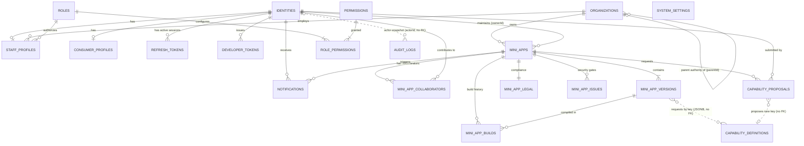
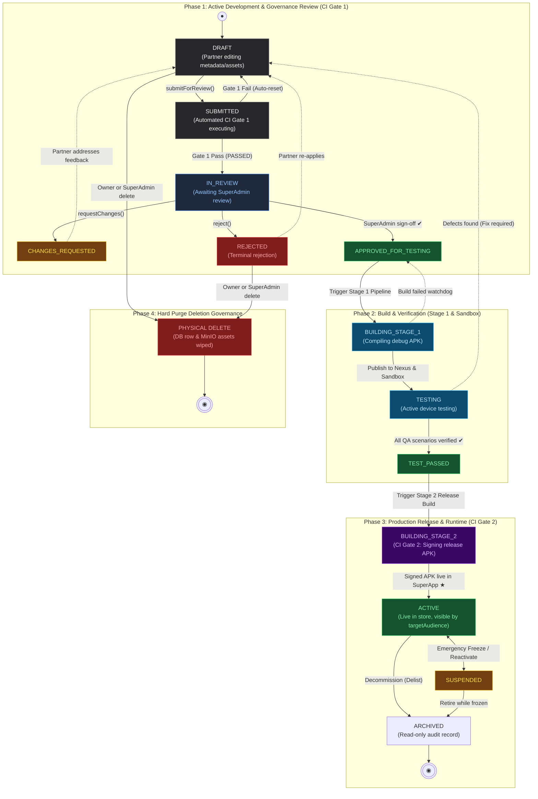
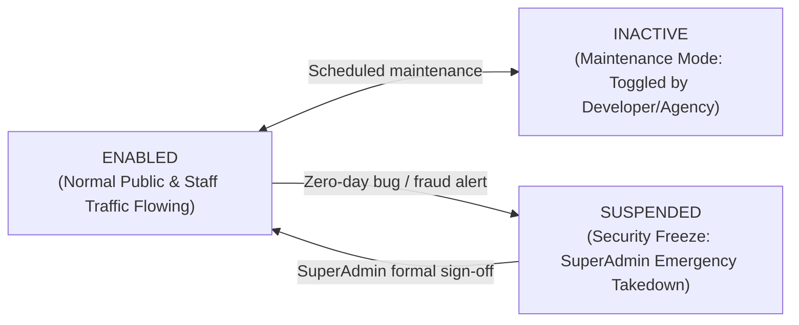
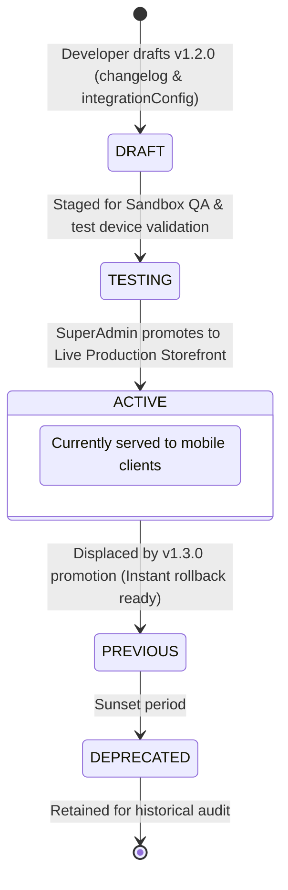
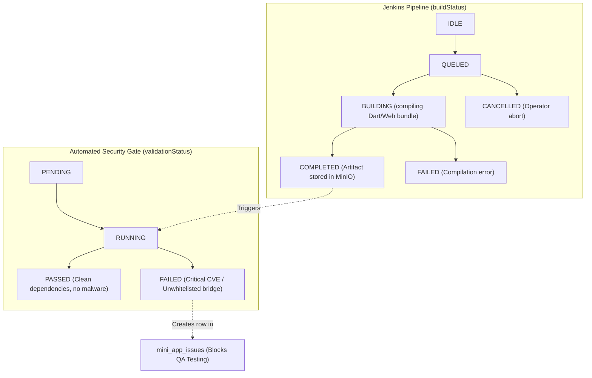
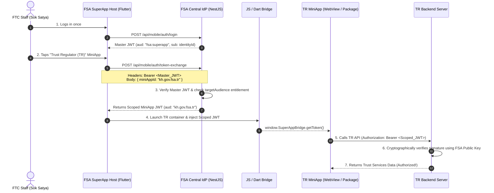

# FSA SuperApp Platform: Database Schema Master Plan

> [!IMPORTANT]
> **Authoritative Specification Document**: This document outlines the reviewed database schema, entity relationships, decoupled status lifecycles, and in-house Single Sign-On (SSO) architecture for the FSA SuperApp ecosystem.
> **Status**: Approved Architecture (Ready for phased non-destructive implementation).

---

## 1. Executive Summary & Core Design Principles

The FSA SuperApp ecosystem serves as a multi-agency digital governance and MiniApp distribution hub for the Non-Bank Financial Services Authority (FSA) of Cambodia, its 11 sector regulatory authorities, and the public. The architecture is built around **6 foundational principles**:

1. **One Identity, Decoupled Profiles & Simplified RBAC**:
   - Replaces monolithic user accounts with a central **`identities`** credential vault.
   - Decoupled into **`staff_profiles`** (for FSA central staff, sector regulators, and developers) and **`consumer_profiles`** (for public citizens).
   - Backoffice RBAC enforces a strict 4-role hierarchy:
     $$\text{SUPER\_ADMIN} \supset \text{ADMIN} \supset \text{MA\_DEVELOPER} \supset \text{STAFF}$$
     where `ADMIN` is strictly a **Sector Regulatory Authority Admin** (e.g. SERC or ACAR Admin) scoped to their agency, and `STAFF` represents general personnel (Accountants, Designers, Inspectors) who consume mobile apps (such as the FSA HR App) without backoffice administrative access.
2. **Multi-Agency Tenancy with Strict Relational Integrity**:
   - `organizations` is the single source of truth for the 11 FSA regulatory authorities and partner entities (`FSA`, `SERC`, `ACAR`, `IRC`, `TR`, `FTC`, etc.).
   - `mini_apps.organizationId` enforces legal ownership with an `ON DELETE RESTRICT` constraint.
   - `staff_profiles.organizationId` scopes employees and developers so they can collaborate on projects within their agency while remaining strictly isolated from other agencies' private apps.
3. **Decoupled Status Dimensions (Zero-Downtime Releases)**:
   - Separates **MiniApp Master Lifecycle** (`mini_apps.lifecycleStatus`: `DRAFT` $\rightarrow$ `SUBMITTED` $\rightarrow$ `IN_REVIEW` $\rightarrow$ `APPROVED_FOR_TESTING` $\rightarrow$ `BUILDING_STAGE_1` $\rightarrow$ `TESTING` $\rightarrow$ `TEST_PASSED` $\rightarrow$ `BUILDING_STAGE_2` $\rightarrow$ `ACTIVE` $\leftrightarrow$ `SUSPENDED` $\rightarrow$ `ARCHIVED`) from **Runtime Availability Gate** (`mini_apps.availabilityStatus`: `ENABLED`, `INACTIVE`, `SUSPENDED`), **Version Release History** (`mini_app_versions.status`: `DRAFT`, `TESTING`, `ACTIVE`, `PREVIOUS`, `DEPRECATED`), and **CI/CD Pipeline Details** (`mini_app_builds.buildStatus` & `validationStatus`).
   - Ensures an active MiniApp continues serving citizens without disruption while a new version is being compiled, scanned, or reviewed.
4. **Regulatory Forensic Auditability**:
   - `audit_logs` records actions immutably without foreign key constraints, using snapshot strings (`actorId`, `actorName`, `actorEmail`, `actorRole`, `resourceId`) to guarantee that legal audit trails remain tamper-evident forever, even after accounts or test apps are deleted.
5. **Native In-House SSO & Dual-Audience Isolation**:
   - **Zero Background Cloning**: Staff and citizens authenticate through their respective profiles without duplicating records or syncing tables.
   - **Internal Token Exchange**: Because external national government SSO is still in pilot development, the FSA SuperApp NestJS backend functions as the authoritative internal **Identity Provider (IdP)**. It issues scoped, audience-restricted RS256 JWTs (`aud: "kh.gov.fsa.tr"`) so staff can access mini-apps across agencies without re-entering passwords.
6. **Universal MiniApp Registry with Method-Specific Versioned Configs**:
   - The core `mini_apps` table holds **only universal storefront and governance attributes** common to all micro-apps.
   - Technical integration details (`baseUrl`, `packageName`, `allowedDomains`, `checksum`) belong to `mini_app_versions.integrationConfig` as polymorphic, version-bound configurations. This prevents nullable column bloat and ensures draft updates never overwrite live production releases.

---

## 2. Complete Ecosystem ERD (Entity-Relationship Diagram)

### Version A: Conceptual ERD (Entities & Relationships Only — No Attributes)

This high-level diagram shows the same 20 entities and the same relationship cardinalities as Version B, without attributes:

* **Solid lines** are enforced foreign keys.
* **Dotted lines** are logical links with no foreign key (see [Section 4](#4-why-some-tables-have-no-direct-foreign-keys)): capabilities are referenced by `key`, and audit actors are snapshots.
* `SYSTEM_SETTINGS` is a global key-value store that no entity owns.



---

### Version B: Detailed Relational ERD (With Full Attributes, Types & Keys)

This diagram specifies all table schemas, data types, primary/foreign keys, and constraints:

```mermaid
erDiagram
    IDENTITIES {
        uuid id PK
        varchar email UK "Enforced lowercase + trimmed"
        varchar name "Full name (e.g. Sok Satya)"
        varchar honorific "HE, LOK_CHUMTEAV, DR, MR, MRS, MISS"
        varchar avatarKey "Private S3/MinIO bucket object key"
        timestamptz avatarUpdatedAt "Cache buster ETag"
        varchar passwordHash "Scrypt / Bcrypt cryptographic hash"
        varchar status "ACTIVE, DISABLED, PENDING_DELETION"
        timestamptz emailVerifiedAt "Decoupled verification instant"
        int failedLoginCount "Anti-brute force counter"
        timestamptz lockedUntil "Lockout window timer"
        timestamptz sessionsRevokedAt "Instant token killswitch"
        timestamptz createdAt
        timestamptz updatedAt
    }

    STAFF_PROFILES {
        uuid id PK
        uuid identityId FK, UK "1:1 with identities (ON DELETE CASCADE)"
        uuid organizationId FK "Mandatory Agency Tenancy (ON DELETE RESTRICT)"
        uuid roleId FK "SUPER_ADMIN, ADMIN, MA_DEVELOPER, STAFF"
        varchar staffId "Unique per agency, e.g. FSA-STAFF-0301"
        varchar position "Job title, e.g. Senior Accountant, Inspector"
        varchar phoneNumber "Official work contact"
        varchar externalId "SSO / Active Directory reference"
        varchar status "ACTIVE, SUSPENDED, TERMINATED"
        timestamptz createdAt
        timestamptz updatedAt
    }

    CONSUMER_PROFILES {
        uuid id PK
        uuid identityId FK, UK "1:1 with identities (ON DELETE CASCADE)"
        varchar phoneNumber "Mobile phone for SMS / OTP"
        timestamptz deletionRequestedAt "Right-to-be-forgotten initiation"
        timestamptz purgeAfter "Hard deletion grace deadline"
        timestamptz createdAt
        timestamptz updatedAt
    }

    ORGANIZATIONS {
        uuid id PK
        varchar name UK "e.g. Non-Bank Financial Services Authority"
        varchar code UK "e.g. FSA, SERC, ACAR, IRC, TR, FTC"
        varchar status "ACTIVE, INACTIVE, SUSPENDED"
        text description
        text logo "Regulatory seal object key"
        uuid parentId FK "Self-referencing sub-regulator link"
        varchar parentAuthority "e.g. Ministry of Economy and Finance"
        timestamptz createdAt
        timestamptz updatedAt
    }

    ROLES {
        uuid id PK
        varchar name UK "SUPER_ADMIN, ADMIN, MA_DEVELOPER, STAFF"
        text description
        boolean isActive
        timestamptz createdAt
        timestamptz updatedAt
    }

    PERMISSIONS {
        uuid id PK
        varchar name UK "e.g. miniapp:create, miniapp:review"
        text description
        timestamptz createdAt
        timestamptz updatedAt
    }

    ROLE_PERMISSIONS {
        uuid roleId PK, FK
        uuid permissionId PK, FK
    }

    MINI_APPS {
        uuid id PK
        varchar appId UK "Reverse domain: kh.gov.fsa.hrmis"
        varchar slug UK "URL slug: fsa-hrmis"
        varchar name "Storefront title: FSA HR App"
        varchar tagline "1-line search hook"
        text description "Full overview and instructions"
        text logo "App icon MinIO object key"
        uuid organizationId FK "Agency Owner (ON DELETE RESTRICT)"
        uuid ownerId FK "Lead Maintainer (identities.id, ON DELETE SET NULL)"
        varchar integrationMethod "WEBVIEW, FLUTTER_PACKAGE, NATIVE_SDK, DEEP_LINK"
        varchar lifecycleStatus "DRAFT, SUBMITTED, IN_REVIEW, APPROVED_FOR_TESTING, BUILDING_STAGE_1, TESTING, TEST_PASSED, BUILDING_STAGE_2, ACTIVE, SUSPENDED, ARCHIVED"
        varchar availabilityStatus "ENABLED, INACTIVE, SUSPENDED"
        varchar targetAudience "PUBLIC, ALL_FSA_STAFF, ORGANIZATION_ONLY"
        varchar supportEmail
        varchar alertTelegramChatId "CI/CD alerts channel"
        varchar currentReleaseVersion "Live production semver pointer (e.g. 1.0.0)"
        varchar activeTestVersion "QA Sandbox semver pointer (e.g. 1.1.0-rc1)"
        varchar draftVersion "Authoring semver pointer (e.g. 1.2.0)"
        timestamptz createdAt
        timestamptz updatedAt
    }

    MINI_APP_VERSIONS {
        uuid id PK
        uuid miniAppId FK "ON DELETE CASCADE"
        varchar version "Semver string: 1.0.0"
        varchar status "DRAFT, TESTING, ACTIVE, PREVIOUS, DEPRECATED"
        text changelog "What's new in this release"
        jsonb integrationConfig "Polymorphic method config (baseUrl / packageName)"
        jsonb capabilities "Requested bridge keys: ['device:biometrics']"
        varchar releasedBy "Identity snapshot of approver"
        timestamptz releasedAt
        timestamptz createdAt
        timestamptz updatedAt
    }

    MINI_APP_BUILDS {
        uuid id PK
        uuid miniAppId FK "ON DELETE CASCADE"
        uuid versionId FK "ON DELETE SET NULL"
        varchar version "Semver snapshot at build time"
        varchar buildStatus "IDLE, QUEUED, BUILDING, COMPLETED, FAILED, CANCELLED"
        varchar validationStatus "PENDING, RUNNING, PASSED, FAILED"
        jsonb validationStages "Automated security scanner checks"
        jsonb validationReport "Security gate checklist results"
        jsonb buildStages "Jenkins pipeline step progress"
        text buildError "Detailed compilation error trace"
        varchar jenkinsJobUrl
        varchar actorId "Identity snapshot who triggered build"
        timestamptz startedAt
        timestamptz completedAt
        timestamptz createdAt
    }

    MINI_APP_COLLABORATORS {
        uuid id PK
        uuid miniAppId FK "ON DELETE CASCADE"
        uuid identityId FK "ON DELETE CASCADE (identities.id)"
        varchar role "ADMIN, DEVELOPER, VIEWER"
        timestamptz createdAt
    }

    MINI_APP_LEGAL {
        uuid id PK
        uuid miniAppId FK, UK "ON DELETE CASCADE"
        text termsUrl
        text termsDescription
        text privacyPolicyUrl
        text privacyPolicyDescription
        timestamptz createdAt
        timestamptz updatedAt
    }

    MINI_APP_ISSUES {
        uuid id PK
        uuid miniAppId FK "ON DELETE CASCADE"
        varchar type
        varchar severity "CRITICAL, HIGH, MEDIUM, LOW"
        text description
        varchar status "OPEN, RESOLVED, WAIVED"
        varchar classification "MINI_APP_ISSUE, SECURITY_GATE"
        jsonb metadata
        timestamptz createdAt
        timestamptz updatedAt
    }

    CAPABILITY_DEFINITIONS {
        uuid id PK
        varchar key UK "device:biometrics, fsa:payment, hardware:camera"
        varchar name
        text description
        varchar category "HARDWARE, DATA, FINANCIAL, SYSTEM"
        boolean isActive
        boolean isDeprecated
        varchar introducedInVersion
        varchar minSuperAppVersion
        jsonb metadata
        timestamptz createdAt
    }

    CAPABILITY_PROPOSALS {
        uuid id PK
        varchar capabilityKey
        varchar capabilityName
        text description
        uuid miniAppId FK "ON DELETE CASCADE"
        uuid requestedById FK "identities.id (ON DELETE SET NULL)"
        varchar status "PENDING_REVIEW, APPROVED, REJECTED"
        text adminDecisionReason
        varchar targetSuperAppVersion
        timestamptz createdAt
    }

    NOTIFICATIONS {
        uuid id PK
        varchar type "HR_ATTENDANCE_REMINDER, REVIEW_UPDATE, SYSTEM_ALERT"
        varchar title
        text message
        boolean isRead
        jsonb metadata
        uuid identityId FK "ON DELETE CASCADE (Recipient)"
        uuid miniAppId FK "ON DELETE CASCADE (Optional origin app)"
        timestamptz createdAt
    }

    DEVELOPER_TOKENS {
        uuid id PK
        uuid identityId FK "ON DELETE CASCADE"
        varchar name "e.g. CI Fastlane Token"
        varchar tokenPrefix "fsa_dev_..."
        varchar tokenHash UK "SHA-256 hash"
        jsonb scopes "['sdk:read', 'packages:read']"
        timestamptz expiresAt
        timestamptz lastUsedAt
        boolean isActive
        timestamptz createdAt
    }

    REFRESH_TOKENS {
        uuid id PK
        uuid familyId
        varchar tokenHash UK "SHA-256 hash"
        uuid identityId FK "ON DELETE CASCADE"
        varchar userAgent
        timestamptz expiresAt
        timestamptz rotatedAt
        timestamptz revokedAt
        timestamptz createdAt
    }

    AUDIT_LOGS {
        uuid id PK
        varchar actorId "Snapshot identity UUID (untyped for permanence)"
        varchar actorName "Snapshot at event time"
        varchar actorEmail "Snapshot at event time"
        varchar actorRole "Snapshot at event time"
        varchar action "e.g. PROMOTE_VERSION, TOKEN_EXCHANGE, SUSPEND_APP"
        varchar resourceType "MiniApp, Identity, Organization"
        varchar resourceId "Target entity snapshot UUID"
        jsonb oldValue
        jsonb newValue
        jsonb metadata
        varchar ipAddress
        varchar userAgent
        timestamptz createdAt
    }

    SYSTEM_SETTINGS {
        varchar key PK "e.g. TOKEN_EXCHANGE_TTL_SECONDS"
        jsonb value
        varchar description
        timestamptz createdAt
        timestamptz updatedAt
    }

    %% Relational Cardinalities
    IDENTITIES ||--o| STAFF_PROFILES : "has"
    IDENTITIES ||--o| CONSUMER_PROFILES : "has"
    IDENTITIES ||--o{ REFRESH_TOKENS : "has active sessions"
    IDENTITIES ||--o{ NOTIFICATIONS : "receives"
    IDENTITIES ||--o{ DEVELOPER_TOKENS : "issues"

    ORGANIZATIONS ||--o{ STAFF_PROFILES : "employs"
    ORGANIZATIONS ||--o{ MINI_APPS : "owns"
    ORGANIZATIONS |o--o{ ORGANIZATIONS : "parent authority of (parentId)"
    ROLES ||--o{ STAFF_PROFILES : "authorizes"
    ROLES ||--|{ ROLE_PERMISSIONS : "configures"
    PERMISSIONS ||--|{ ROLE_PERMISSIONS : "granted"

    IDENTITIES ||--o{ MINI_APPS : "maintains (ownerId)"
    MINI_APPS ||--o{ MINI_APP_COLLABORATORS : "has collaborators"
    IDENTITIES ||--o{ MINI_APP_COLLABORATORS : "contributes to"
    MINI_APPS ||--|{ MINI_APP_VERSIONS : "contains"
    MINI_APPS ||--|| MINI_APP_LEGAL : "compliance"
    MINI_APPS ||--o{ MINI_APP_ISSUES : "security gates"
    MINI_APPS ||--o{ MINI_APP_BUILDS : "build history"
    MINI_APP_VERSIONS ||--o{ MINI_APP_BUILDS : "compiled in"
    MINI_APPS ||--o{ CAPABILITY_PROPOSALS : "requests"
    IDENTITIES ||--o{ CAPABILITY_PROPOSALS : "submitted by"
    MINI_APPS ||--o{ NOTIFICATIONS : "triggers"
```



---

## 3. Decoupled Status Architecture & Workflows

To guarantee **zero downtime** and ensure that broken builds or pending reviews never disrupt live production services, status lifecycles are decoupled into **4 independent dimensions**:

```
┌──────────────────────────────────────────────────────────────────────────────────┐
│                             THE 4 STATUS DIMENSIONS                              │
├─────────────────────────┬────────────────────────────────────────────────────────┤
│ Dimension 1 (Lifecycle) │ High-level registry state of the MiniApp record        │
│ Dimension 2 (Gate)      │ Operational runtime killswitch (Live traffic gate)     │
│ Dimension 3 (Release)   │ Version-by-version authoring, review, & promotion      │
│ Dimension 4 (CI/CD)     │ Automated compilation, linting, & security scan jobs   │
└─────────────────────────┴────────────────────────────────────────────────────────┘
```

---

### Process Flow 1: MiniApp Master Lifecycle (`mini_apps.lifecycleStatus`)
*Faithfully synchronized with [`diagrams/miniapp-lifecycle-diagram.svg`](file:///d:/Projects/fintect/superapp/superapp-poc/diagrams/miniapp-lifecycle-diagram.svg) and [`miniapp.entity.ts`](file:///d:/Projects/fintect/superapp/superapp-poc/superapp_backend/src/miniapps/entities/miniapp.entity.ts)*:



---

### Process Flow 2: Runtime Operational Gate / Killswitch (`mini_apps.availabilityStatus`)
An operational switch that manages live user traffic independently of versions:



* **`ENABLED`**: Live and accessible on mobile devices matching `targetAudience`.
* **`INACTIVE`**: MiniApp displays a friendly *"Under scheduled maintenance"* screen. The lead maintainer (`ownerId`) can toggle this for routine upgrades without administrative review.
* **`SUSPENDED`**: Formal emergency regulatory freeze. Terminally hidden from mobile catalog and token exchange. Only a `SUPER_ADMIN` (or authorized sector `ADMIN`) can execute or lift this.

#### Immediate System Reactions on Suspension
When a MiniApp transitions to `SUSPENDED`, four automated security actions execute across the platform:
1. **Mobile SuperApp Delisting**: The MiniApp immediately disappears from the mobile home feed, search, and category grids. If opened via deep link, the container is blocked with a regulatory alert: *"This service has been temporarily suspended by regulatory authority."*
2. **Token Exchange Gateway Severing**: The backend token exchange endpoint (`POST /api/mobile/auth/token-exchange`) immediately rejects requests with HTTP `403 Forbidden`, cutting off the MiniApp from issuing or renewing scoped JWTs.
3. **Forensic Audit Snapshot**: A permanent event is written to `audit_logs` (`action: 'SUSPEND_MINI_APP'`, `actorId`, `actorName`, `actorRole`, `reason`, `timestamp`) with zero foreign keys.
4. **Automated Team Broadcast**: An emergency alert is dispatched to `mini_apps.alertTelegramChatId` notifying the agency lead maintainer and development team.

---

### Process Flow 3: Per-Version Release Workflow (`mini_app_versions.status`)
How an individual semver release (e.g. `v1.2.0`) progresses through governance:



---

### Process Flow 4: CI/CD Pipeline & Security Scans (`mini_app_builds`)
The real-time execution states of Jenkins compilation jobs and automated security gates:



---

### Detailed Status Comparison Matrix

| Status Dimension | Target Entity | Permitted Values | Business Purpose & Reversibility |
| :--- | :--- | :--- | :--- |
| **Dimension 1: Lifecycle** | `mini_apps` | `DRAFT`, `SUBMITTED`, `IN_REVIEW`, `APPROVED_FOR_TESTING`, `BUILDING_STAGE_1`, `TESTING`, `TEST_PASSED`, `BUILDING_STAGE_2`, `ACTIVE`, `SUSPENDED`, `ARCHIVED` | High-level regulatory state machine. Governed by formal review milestones and CI gates. |
| **Dimension 2: Availability** | `mini_apps` | `ENABLED`, `INACTIVE`, `SUSPENDED` | Instant runtime killswitch. `INACTIVE` is controlled by the app maintainer; `SUSPENDED` is restricted to SuperAdmins. |
| **Dimension 3: Release** | `mini_app_versions` | `DRAFT`, `TESTING`, `ACTIVE`, `PREVIOUS`, `DEPRECATED` | Tracks immutable version packages (`1.0.0` vs `1.1.0`). `PREVIOUS` versions allow instant 1-click rollback. |
| **Dimension 4: CI/CD** | `mini_app_builds` | `IDLE`, `QUEUED`, `BUILDING`, `COMPLETED`, `FAILED`, `CANCELLED` | Pipeline compilation and static analysis runs. Isolated from live production. |

---

## 4. Why Some Tables Have No Direct Foreign Keys

In enterprise systems, omitting foreign keys is done deliberately for resilience and forensic security:

1. **`audit_logs` (`actorId`, `actorName`, `actorEmail`, `actorRole`, `resourceId`)**:
   - **No Foreign Keys**: If a foreign key with `ON DELETE CASCADE` were attached, deleting a test user or identity would **permanently destroy the audit trail** of what that user did. If `ON DELETE RESTRICT` were used, you could **never delete any identity** because audit logs would block deletion forever. Using untyped UUID strings ensures audit logs remain **100% immutable and forensically permanent**.
   - **Identity Snapshotting (`actorName`, `actorEmail`, `actorRole`)**: Storing snapshots of the actor's details at the moment of the event enables instant human readability in backoffice dashboards without expensive SQL joins. If an employee leaves the agency, auditors can still immediately identify exactly who initiated every deployment or security override.
2. **`capability_definitions` (`key`, `name`)**:
   - Functions as a dynamic system catalog / dictionary of bridge APIs (Camera, Biometrics, Payment) supported by the Flutter host shell.
   - Version records request capabilities via `mini_app_versions.capabilities` (JSONB array), which is validated dynamically during CI/CD builds rather than through a rigid join table.
   - **Linked by `key`, enforced by the security gate (deliberate design decision)**:
     - **Where keys are referenced**: `mini_apps.capabilities` (working copy), `miniapp_versions.permissions` (frozen per release), and `pendingRevision.capabilities`. Each item is either a key string or an object `{ type, purpose, termsUrl }`, and keys are matched case-insensitively.
     - **Why there is no FK**:
       - PostgreSQL cannot put a foreign key on elements inside a JSONB array.
       - `capability_proposals.capabilityKey` names a capability that does not exist yet, until it is approved and shipped.
       - The catalog is synced from the Super App source on boot and is never hard-deleted: retired capabilities get `isActive = false` / `isDeprecated = true`, so historical versions keep pointing at a real row.
     - **Why a FK is also undesirable**: the platform policy is *disable, don't fail*. A Mini App may register with a capability the Super App does not support yet, and that capability stays disabled until a host release adds it ([ADR-004 Section 5](./ADR-004-CAPABILITY-GENERATOR-AND-SDK-RUNTIME-CONTRACT.md#5-registration-policy-for-unsupported-capabilities-graceful-degradation)). A foreign key would reject such a registration outright.
     - **How unsupported keys are handled**: the `capability_gate` stage checks every declared key with `CapabilitiesService.findByKey()` and reports `CAP_UNSUPPORTED_<KEY>`. An optional capability gets a LOW finding and is disabled; a required one gets a MEDIUM finding and makes the Mini App not launchable ("Unavailable until Super App vX"). Supported/disabled is computed when read, never stored, so a capability switches on automatically once the catalog sync adds it.
     - **Coverage**: all four integration methods run the shared `CapabilityGateService` check (`capability_gate` is mandatory for every method).
     - **Accepted trade-off**: the database itself does not reject an unknown key; integrity depends on the gate and on the launch check in token exchange. If database enforcement is ever required, the preferred option is a `miniapp_version_capabilities` link table (`versionId`, `capabilityKey` FK to `capability_definitions.key`, `purpose`, `termsUrl`) filled at version promotion. It enforces released versions only, so drafts keep the friendly findings.
3. **`system_settings` (`key`, `value`)**:
   - Global key-value environment configuration (pipeline timeouts, MinIO retention rules, Telegram bot webhooks). It is not owned by any entity.

---

## 5. Streamlined `organizations` Schema & Behavioral Matrix

### Table Definition
```sql
CREATE TABLE organizations (
    id UUID PRIMARY KEY DEFAULT gen_random_uuid(),
    name VARCHAR(255) NOT NULL UNIQUE,
    code VARCHAR(50) NOT NULL UNIQUE,             -- e.g., 'FSA', 'SERC', 'ACAR', 'IRC', 'TR', 'FTC'
    status VARCHAR(50) NOT NULL DEFAULT 'ACTIVE', -- 'ACTIVE', 'INACTIVE', 'SUSPENDED'
    description TEXT NULL,
    logo TEXT NULL,                               -- Regulatory crest object key
    "parentId" UUID NULL REFERENCES organizations(id) ON DELETE SET NULL,
    "parentAuthority" VARCHAR(255) NULL,          -- e.g., 'Non-Bank Financial Services Authority'
    "createdAt" TIMESTAMPTZ NOT NULL DEFAULT NOW(),
    "updatedAt" TIMESTAMPTZ NOT NULL DEFAULT NOW()
);
```

### Behavioral Matrix on UPDATE or DELETE

| Event | Target Entity | Database Action | Business Guarantee |
| :--- | :--- | :--- | :--- |
| **UPDATE Name or Logo** | `mini_apps`, `staff_profiles` | Relational joins use immutable `organizationId` UUID. Updates reflect immediately. | Zero data backfills needed. All backoffice badges and app listings update instantly. |
| **DELETE Organization** | `mini_apps` | **`ON DELETE RESTRICT`**: PostgreSQL **blocks and rejects deletion** if the agency owns any MiniApps. | **Safety Guarantee**: Protects against accidental deletion of a regulator that has live apps on citizens' phones. |
| **DELETE Organization** | `staff_profiles` | **`ON DELETE RESTRICT`**: PostgreSQL **blocks deletion** if any staff profiles are currently assigned. | Prevents leaving active staff in an unassigned agency void. |

---

## 6. Identity, Profiles & Role Hierarchy

### 1. Database DDL: Identities & Decoupled Profiles

```sql
-- 1. Central Credential & Authentication Vault
CREATE TABLE identities (
    id UUID PRIMARY KEY DEFAULT gen_random_uuid(),
    email VARCHAR(255) NOT NULL UNIQUE,
    name VARCHAR(255) NOT NULL,
    honorific VARCHAR(50) NULL,                   -- 'HE', 'LOK_CHUMTEAV', 'DR', 'MR', 'MRS', 'MISS'
    "avatarKey" VARCHAR(255) NULL,                -- Private S3/MinIO bucket object key
    "avatarUpdatedAt" TIMESTAMPTZ NULL,
    "passwordHash" VARCHAR(255) NOT NULL,         -- Scrypt cryptographic hash
    status VARCHAR(50) NOT NULL DEFAULT 'ACTIVE', -- 'ACTIVE', 'DISABLED', 'PENDING_DELETION'
    "emailVerifiedAt" TIMESTAMPTZ NULL,           -- Explicit verification timestamp
    "failedLoginCount" INT NOT NULL DEFAULT 0,
    "lockedUntil" TIMESTAMPTZ NULL,
    "sessionsRevokedAt" TIMESTAMPTZ NULL,
    "createdAt" TIMESTAMPTZ NOT NULL DEFAULT NOW(),
    "updatedAt" TIMESTAMPTZ NOT NULL DEFAULT NOW(),
    CONSTRAINT "CHK_identities_email_lowercase" CHECK ("email" = lower("email"))
);

-- 2. Staff Profiles (FSA & Regulator Personnel)
CREATE TABLE staff_profiles (
    id UUID PRIMARY KEY DEFAULT gen_random_uuid(),
    "identityId" UUID NOT NULL UNIQUE REFERENCES identities(id) ON DELETE CASCADE,
    "organizationId" UUID NOT NULL REFERENCES organizations(id) ON DELETE RESTRICT,
    "roleId" UUID NOT NULL REFERENCES roles(id) ON DELETE RESTRICT,
    "staffId" VARCHAR(50) NULL,                   -- e.g., 'FSA-STAFF-0301' (Digital ID Card No.)
    position VARCHAR(100) NULL,                   -- e.g., 'Senior Accountant', 'Chief Inspector'
    "phoneNumber" VARCHAR(30) NULL,
    "externalId" VARCHAR(255) NULL,               -- Government SSO / Active Directory reference
    status VARCHAR(50) NOT NULL DEFAULT 'ACTIVE', -- 'ACTIVE', 'SUSPENDED', 'TERMINATED'
    "createdAt" TIMESTAMPTZ NOT NULL DEFAULT NOW(),
    "updatedAt" TIMESTAMPTZ NOT NULL DEFAULT NOW(),
    CONSTRAINT "UQ_staff_agency_staffId" UNIQUE ("organizationId", "staffId")
);

-- 3. Consumer Profiles (General Public / Mobile Citizens)
CREATE TABLE consumer_profiles (
    id UUID PRIMARY KEY DEFAULT gen_random_uuid(),
    "identityId" UUID NOT NULL UNIQUE REFERENCES identities(id) ON DELETE CASCADE,
    "phoneNumber" VARCHAR(30) NULL,
    "deletionRequestedAt" TIMESTAMPTZ NULL,       -- Apple / Google App Store mandatory account deletion
    "purgeAfter" TIMESTAMPTZ NULL,                -- Grace period timer before hard delete
    "createdAt" TIMESTAMPTZ NOT NULL DEFAULT NOW(),
    "updatedAt" TIMESTAMPTZ NOT NULL DEFAULT NOW()
);
```

---

### 2. Role Taxonomy & Authority Scope

```
SUPER_ADMIN (FSA Central Platform Admin: cross-agency approvals, system configs)
  └── ADMIN (Sector Regulator Admin: approves apps & staff inside their own organization)
        ├── MA_DEVELOPER (Engineers: writes code, builds packages, sandbox QA)
        └── STAFF (General Personnel: HR attendance, ID card, staff notices; no backoffice admin)
```

| Role | Workplace | Backoffice Web Capabilities | Mobile SuperApp Capabilities |
| :--- | :--- | :--- | :--- |
| **`SUPER_ADMIN`** | Central IT / Operations | Universal platform control, all agencies, approvals. | All staff apps + administrative previews. |
| **`ADMIN`** | Regulatory Authority | Governs staff and MiniApps within their agency. | Staff apps within agency + regulator tools. |
| **`MA_DEVELOPER`** | Development Team | MiniApp authoring, builds, testing, capability requests. | Developer sandbox testing on real devices. |
| **`STAFF`** | General Personnel | None (or read-only internal directory). | **FSA HR App** (Attendance, Digital ID Card), internal agency mini-apps. |
| **Citizen (`Consumer`)** | General Public | None. | Public mini-apps only (`targetAudience = 'PUBLIC'`). |

---

### 3. Mobile Backward-Compatible API Contract

To protect your teammate's Flutter mobile SuperApp and MiniApps from breaking changes, the backend projects `identity + staff_profile + consumer_profile` into the **exact same JSON contract** that the Flutter models expect:

#### `GET /api/mobile/auth/profile`
```json
{
  "id": "e4b1c2d3-987a-4c22-b50a-81a17932c0fa",
  "email": "sok.satya@fsa.gov.kh",
  "name": "Sok Satya",
  "honorific": "HE",
  "emailVerified": true,
  "status": "ACTIVE",
  "position": "Senior Accountant",
  "organizationUnit": "Non-Bank Financial Services Authority",
  "staffId": "FSA-STAFF-0301",
  "avatarVersion": "2026-11-05T08:00:00.000Z"
}
```
* **Guarantee**: The mobile Flutter app does not know or care how many SQL tables are joined. The JSON keys remain 100% identical.

---

## 7. MiniApp Governance, Ownership & Audience Distribution

There is a strict architectural boundary between **Developer Collaboration** (who builds the app in the backoffice) and **Mobile Storefront Discovery** (who sees and uses the app on their phone):

```
       BACKOFFICE COLLABORATION                  MOBILE STORE DISCOVERY
    ┌─────────────────────────────┐           ┌─────────────────────────────┐
    │   mini_app_collaborators    │           │   mini_apps.targetAudience  │
    ├─────────────────────────────┤           ├─────────────────────────────┤
    │ ADMIN (Co-maintainer)       │           │ PUBLIC (Citizens + Staff)   │
    │ DEVELOPER (Code/Build/Test) │           │ ALL_FSA_STAFF (FSA HR App)  │
    │ VIEWER (Read-only QA)       │           │ ORGANIZATION_ONLY (Internal)│
    └─────────────────────────────┘           └─────────────────────────────┘
```

### Mobile Target Audience Policy (`mini_apps.targetAudience`)

1. **`PUBLIC`**: Visible to all citizens (`consumer_profiles`) and all staff. Examples: Public Trust Search, Insurance Registry, Tax Verification.
2. **`ALL_FSA_STAFF`**: Visible to any authenticated identity with an active `staff_profiles` record across all 11 regulatory authorities. Example: **FSA HR App** (HRMIS attendance, staff announcements, digital ID card). Citizens cannot see this app.
3. **`ORGANIZATION_ONLY`**: Visible strictly to staff belonging to the publishing regulator (`staff_profile.organizationId === mini_app.organizationId`). Example: Internal SERC Market Surveillance Tool, ACAR Auditor Checklist.

---

### Role Authority Matrix for Emergency Suspension (`miniapp:suspend`)

Emergency suspension is executed via `POST /api/miniapps/:id/suspend` and is gated by the RBAC permission **`miniapp:suspend`**:

| Role | Can Suspend? | Authority Scope | Business Rationale |
| :--- | :---: | :--- | :--- |
| **`SUPER_ADMIN`** | ✅ **YES** | **Universal / Cross-Agency**<br>(Can suspend *any* MiniApp across all 11 regulators) | Highest platform authority (FSA Central IT / FinTech Center). Intervenes for platform-wide zero-days, national security, or central financial fraud. |
| **`ADMIN`**<br>*(Sector Regulator Admin)* | ✅ **YES** | **Own Agency ONLY**<br>(Scoped strictly by `staff_profile.organizationId`) | Sector regulatory head (e.g. **SERC Admin**, **ACAR Admin**, **TR Admin**). Can suspend an app published by their own authority. Blocked by firewall from touching other agencies' apps. |
| **`MA_DEVELOPER`**<br>*(MiniApp Developer / Owner)* | ❌ **NO** | *None*<br>(Permission denied for regulatory suspension) | A developer cannot issue a formal regulatory sanction against an app. Instead, developers have **Maintenance Mode (`INACTIVE`)** to pause traffic safely. |
| **`STAFF`**<br>*(General Personnel)* | ❌ **NO** | *None* | Regular employees (Accountants, HR officers, Designers) who consume mobile apps. No backoffice administrative rights. |
| **Citizen (`Consumer`)** | ❌ **NO** | *None* | Mobile consumers have no backoffice access. |

#### Backend Access Guard & Tenancy Firewall

```typescript
// 1. RBAC Permission Gate
if (!user.permissions.includes('miniapp:suspend')) {
  throw new ForbiddenException('You do not have permission to suspend MiniApps');
}

// 2. Agency Tenancy Firewall
if (user.role === 'ADMIN') {
  // Sector Regulator Admin can ONLY suspend apps within their own agency!
  if (user.organizationId !== miniApp.organizationId) {
    throw new ForbiddenException(
      'Access Denied: You cannot suspend a MiniApp belonging to another regulatory authority'
    );
  }
}

// 3. SuperAdmin has Universal Scope (organizationId check bypassed)
```

#### Reactivation (Unsuspension) Protocol
* **Developers Cannot Unsuspend**: A developer cannot override a government regulatory order.
* **Administrative Clearance Required**: Only a `SUPER_ADMIN` (or the authorizing agency `ADMIN`) can verify the security fix, input a mandatory clearance reason, and restore `availabilityStatus` to `ENABLED`.
* **Zero Deletion While Suspended**: Per Phase 4 Deletion Governance, an app in `SUSPENDED` status **cannot be physically deleted** by anyone. This guarantees that forensic evidence is preserved permanently.

---

## 8. MiniApp Normalization: Universal Registry & Method Configs

### 1. Cleaned Universal `mini_apps` Table DDL

```sql
CREATE TABLE mini_apps (
    id UUID PRIMARY KEY DEFAULT gen_random_uuid(),
    "appId" VARCHAR(255) NOT NULL UNIQUE,          -- e.g. 'kh.gov.fsa.hrmis'
    slug VARCHAR(255) NOT NULL UNIQUE,             -- e.g. 'fsa-hrmis'
    name VARCHAR(255) NOT NULL,
    tagline VARCHAR(255) NULL,                     -- 1-line search hook
    description TEXT NULL,                         -- Full storefront overview
    logo TEXT NULL,                                -- App icon MinIO object key
    
    -- Agency Tenancy & Ownership
    "organizationId" UUID NOT NULL REFERENCES organizations(id) ON DELETE RESTRICT,
    "ownerId" UUID NULL REFERENCES identities(id) ON DELETE SET NULL,
    
    -- Technical Architecture
    "integrationMethod" VARCHAR(50) NOT NULL,      -- 'WEBVIEW', 'FLUTTER_PACKAGE', 'NATIVE_SDK', 'DEEP_LINK'
    
    -- Status & Audience
    "lifecycleStatus" VARCHAR(50) NOT NULL DEFAULT 'DRAFT',
    "availabilityStatus" VARCHAR(50) NOT NULL DEFAULT 'ENABLED',
    "targetAudience" VARCHAR(50) NOT NULL DEFAULT 'PUBLIC',
    
    -- Operational Channels
    "supportEmail" VARCHAR(255) NULL,
    "alertTelegramChatId" VARCHAR(100) NULL,
    
    -- Fast Version Pointer Cache
    "currentReleaseVersion" VARCHAR(50) NULL,      -- e.g. '1.0.0' (Live production)
    "activeTestVersion" VARCHAR(50) NULL,          -- e.g. '1.1.0-rc1' (Sandbox QA)
    "draftVersion" VARCHAR(50) NULL,               -- e.g. '1.2.0' (Authoring draft)
    
    "createdAt" TIMESTAMPTZ NOT NULL DEFAULT NOW(),
    "updatedAt" TIMESTAMPTZ NOT NULL DEFAULT NOW()
);
```

---

### 2. Version-Bound Polymorphic Configurations (`mini_app_versions.integrationConfig`)

All technical integration fields are stored inside `mini_app_versions.integrationConfig` (JSONB) and validated strictly by NestJS DTOs:

#### A. If `integrationMethod === 'WEBVIEW'`
```json
{
  "baseUrl": "https://hrmis.fsa.gov.kh/app",
  "allowedDomains": ["hrmis.fsa.gov.kh", "api.fsa.gov.kh"],
  "requireHttps": true,
  "verificationToken": "fsa-verify-987a123b",
  "isDomainVerified": true,
  "domainVerifiedAt": "2026-11-05T08:00:00.000Z"
}
```

#### B. If `integrationMethod === 'FLUTTER_PACKAGE'`
```json
{
  "packageName": "fsa_hrmis",
  "entryPointClass": "HrmisMiniAppEntry",
  "gitRef": "v1.1.0",
  "artifactUrl": "minio://packages/fsa_hrmis/1.1.0/bundle.tar.gz",
  "apkSize": "4.2 MB",
  "checksum": "sha256:e3b0c44298fc1c149afbf4c8996fb92427ae41e4649b934ca495991b7852b855",
  "minSuperAppVersion": "2.1.0"
}
```

#### C. If `integrationMethod === 'DEEP_LINK'`
```json
{
  "customScheme": "fsatrust://",
  "universalLinkHost": "trust.fsa.gov.kh",
  "appStoreUrl": "https://apps.apple.com/app/id123456",
  "playStoreUrl": "https://play.google.com/store/apps/details?id=kh.gov.fsa.trust"
}
```

* **Zero-Downtime Guarantee**: If version `1.1.0` changes its `baseUrl` or package bundle, version `1.0.0` continues running live with its own immutable configuration until `1.1.0` is officially promoted to `ACTIVE`.

---

## 9. In-House MiniApp Token Exchange (SSO) Architecture

Because external government Single Sign-On (CamDX / national Keycloak) is still in active development, **the FSA SuperApp NestJS backend serves as the authoritative internal Identity Provider (IdP)**.

### The Security Principle: Master Token vs. Scoped MiniApp Token

* **The Rule**: The SuperApp Master Access Token is **NEVER** shared with MiniApps!
* **The Reason**: MiniApps may be developed by external vendor teams or third-party partner ministries. If a MiniApp receives the Master Token, a compromised MiniApp could impersonate the user across the Backoffice or other regulatory services.

---

### The RFC 8693 Token Exchange Flow



---

### What Does the Scoped MiniApp JWT Contain?

```json
{
  "iss": "https://superapp.fsa.gov.kh",
  "sub": "e4b1c2d3-987a-4c22-b50a-81a17932c0fa",
  "aud": "kh.gov.fsa.tr",
  "name": "Sok Satya",
  "honorific": "HE",
  "email": "satya.sok@fsa.gov.kh",
  "organizationCode": "FTC",
  "staffId": "FSA-STAFF-0301",
  "position": "Senior Accountant",
  "scope": "trust:read trust:register",
  "exp": 1794050900,
  "iat": 1794050000
}
```

1. **Audience-Restricted (`aud: "kh.gov.fsa.tr"`)**: If this token is leaked or intercepted, the Insurance Regulator (IRC) or Banking authority will immediately reject it because `aud !== "kh.gov.fsa.irc"`.
2. **Stateless Verification**: The TR server does not need to connect to the FSA database. It verifies the signature against the FSA public key (JWKS) locally in RAM in 0.1 milliseconds.

---

## 10. Phased Implementation & Non-Destructive Migration Roadmap

To transition safely without corrupting existing data or causing downtime, the migration is executed in structured phases:

```markdown
- [x] **Phase 1: Create New Core Identity Tables (DDL Execution)**
  - [x] Create `identities` table with lowercase email constraint, credentials, lockout, and session revocation timestamps.
  - [x] Create `staff_profiles` table with agency tenancy, role relation, unique staff ID, and employment fields.
  - [x] Create `consumer_profiles` table with phone number, deletionRequestedAt, and purgeAfter fields.
  - [x] Implemented TypeORM migration: `1794200000000-CreateIdentitiesAndProfilesSchema.ts`.

- [x] **Phase 2: Transactional Data Migration Script**
  - [x] Created `scripts/migrate-to-identities-schema.mjs` with atomic PostgreSQL transaction (`BEGIN ... COMMIT`).
  - [x] Migrate rows from `users` -> `identities` (credentials) and `staff_profiles` (employment details).
  - [x] Migrate rows from `end_users` -> `identities` (if unique) and `consumer_profiles`.
  - [x] Handle dual-profile resolution (if same email exists in both, link both staff & consumer profiles to one identity).

- [x] **Phase 3: Foreign Key Re-Anchoring**
  - [x] Missing `identities` columns added and all identity FKs repointed from legacy `"user"` / `end_users` to `identities(id)`, with legacy ids remapped by email: `1794300000000-AlignIdentitiesColumnsAndForeignKeys.ts`.
  - [x] Repoint `mini_apps.ownerId` -> `identities(id)` (`ON DELETE SET NULL`).
  - [x] Repoint `mini_app_collaborators.userId` -> `identityId REFERENCES identities(id)`.
  - [x] Repoint `notifications.userId` -> `identityId REFERENCES identities(id)`.
  - [x] Repoint `developer_tokens.userId` -> `identityId REFERENCES identities(id)`. Developer and personal access tokens share this table; there is no separate `access_tokens` table.
  - [x] Repoint `end_user_refresh_tokens.endUserId` -> `refresh_tokens.identityId REFERENCES identities(id)`.
  - [x] Repoint `capability_proposals.requestedById` -> `identities(id)` (`ON DELETE SET NULL`).

- [x] **Phase 3b: Physical Schema Alignment** (`1794400000000-MatchSchemaMasterPlan.ts`)
  - [x] Tables renamed to the documented names: `roles`, `permissions`, `notifications`, `mini_app_versions`, `mini_app_builds`, `mini_app_legal`, `mini_app_issues`, `refresh_tokens`.
  - [x] Identity FK columns renamed to `identityId`. Entity properties keep their old names (`userId`, `endUserId`) through column mapping, so API responses are unchanged.
  - [x] `mini_apps.organizationId` is `NOT NULL` with `ON DELETE RESTRICT`. Legacy rows were resolved by organization code, then name, then the owner's agency, then the root FSA authority.
  - [x] `organizations.code` is `NOT NULL UNIQUE`. Missing codes were generated from name initials and duplicates suffixed (`-2`, `-3`, ...). New organizations get a generated code when none is supplied.
  - [x] `organizations.status` gained `SUSPENDED`. It is still a PostgreSQL enum rather than `VARCHAR`; the allowed values match the doc.
  - [x] `UQ_staff_agency_staffId` (unique `organizationId` + `staffId`). Existing duplicates were suffixed.
  - [x] Legacy tables dropped after a final copy of legacy capability rows: `user`, `end_users`, `user_roles`, `permission_proposals`, `permission_definitions`, `miniapp_activities`. **Irreversible: take a database backup before deploying.**
  - [x] Kept because live entities still use them: `auth_otps`, `superapp_capabilities`, `end_user_email_verification_tokens`.

- [ ] **Phase 3c: Remaining Differences From This Specification** (not yet implemented)
  - [ ] **Run history (`mini_app_scans`, `mini_app_builds`)**, in steps:
    - [x] 1a Expand (migration `CreateMiniAppScans`): `mini_app_scans` holds one row per scan run (scope `APP` or `REVISION`, status, stages, report, errors, checks), so a failed revision scan no longer looks like the live version's result. `mini_app_builds` lost its unused `validation*` columns and gained `buildType`. Existing state is backfilled. Triggers `trg_mini_app_scan_sync` and `trg_mini_app_build_sync` copy every change of the legacy `mini_apps` columns (and of the scan fields in `pendingRevision`) into a run row; a trigger error only logs a WARNING. History endpoints: `GET /mini-apps/:id/scans`, `GET /mini-apps/:id/builds`.
    - [x] 1b Writers record runs directly (with `actorId`) through `MiniAppRunsService`, and reads (build inclusion, detail page, four-eyes submitter) use the run tables.
    - [x] 1c Contract (migration `DropRunColumnsFromMiniApps`): the `validation*` and `build*` columns and the two triggers are gone from `mini_apps`; API responses still carry those fields, filled from the latest runs. (`securityChecks` stays: it is configuration, not a run.)
  - [ ] **Capabilities per version (`mini_app_version_capabilities`)**, in steps:
    - [x] 2a Expand (migration `CreateMiniAppVersionCapabilities`): one row per capability key per version (`required`, `purpose`, the entry as declared, `REQUESTED`/`APPROVED`, `approvedById`/`approvedAt`). `mini_app_versions` rows are written again (`MiniAppVersionsService`; nothing had written them since `versionHistory` stopped being a column): an unreleased app has one working row (DRAFT, TESTING, then ACTIVE), a live app one ACTIVE row and, while a revision is pending, one DRAFT row for it. A subscriber syncs the rows after every committed save of a mini app; approve, publish revision and rollback are explicit calls. The backfill normalized old statuses and marked surplus rows DEPRECATED (no rows deleted). `GET /mini-apps/:id/version-capabilities`.
    - [ ] 2b Switch reads (gate, mobile catalog, token exchange, detail page) to the version rows, then drop `mini_apps.capabilities`, `mini_app_versions.permissions` and `pendingRevision.capabilities`.
  - [ ] **Pending revision as a version row** (step 3): the DRAFT row holds the whole revision, not only its capabilities; `pendingRevision` goes.
  - [ ] **Integration config on the version** (step 4): `integrationConfig`, verification fields and `homeWidget` move to `mini_app_versions`; the mobile response keeps its shape.
  - [ ] `mini_apps` slimming (Section 8): about 20 legacy technical columns (`integrationConfig`, `validation*`, `build*`, `verificationToken`, `isDomainVerified`, `status`, `version`, `versionHistory`, `permissions`, `capabilities`, `organization`, `organizationCode`, `teamName`, `teamTelegramChatId`, `sharingScope`, and others) still live on `mini_apps` instead of `mini_app_versions.integrationConfig`. Touches about 500 code references; planned as a separate refactor.
  - [ ] `mini_app_versions` still has top-level `packageName`, `gitRef`, `artifactUrl`, `checksum`, `apkSize`, `type`, and stores capabilities in `permissions` (doc: `capabilities`).
  - [ ] `organizations` still has `domain`, `contactEmail`, `contactPhone`, `metadata`.
  - [ ] `identities` additionally has `deletionRequestedAt`, `purgeAfter` (also on `consumer_profiles`) and `telegramChatId`, `telegramUsername`, `telegramConnectedAt`.

- [x] **Phase 4: NestJS Backend Entity & Service Refactor**
  - [x] Implement `Identity`, `StaffProfile`, and `ConsumerProfile` TypeORM entities.
  - [x] Implement `POST /api/mobile/auth/token-exchange` endpoint in `MobileAuthService` (RFC 8693 SSO with audience & agency locks).
  - [x] Ensure `GET /api/mobile/auth/profile` preserves the exact `ProfileResponse` contract.
  - [x] Ensure Backoffice users projection (`FormattedUserResponse`) preserves full compatibility with Next.js backoffice.
  - [x] Refactor AccessControl, Notifications, Organizations, Audit, and Mobile modules.

- [x] **Phase 5: Verification & Safety Sign-off**
  - [x] Verify official accounts (`molikakhorn71@gmail.com`, `lymoly1122@gmail.com`) seed and authenticate properly.
  - [x] Verify mobile sign-in returns full staff profile (`staffId`, `position`, `organizationUnit`).
  - [x] Verified zero TypeScript compilation errors in backend (`pnpm run build`).
  - [x] Verified zero Next.js build errors in backoffice (`pnpm --dir superapp_backoffice build` - 42/42 pages).
  - [x] Ran backend unit tests: **72 passed, 72 total test suites; 716 passed, 716 total tests**.
  - [x] Safely deleted legacy entities `user.entity.ts` and `end-user.entity.ts`.
```
